# LegalMaster Solo — system inputs, outputs, and data-flow report

**Audit date:** 2026-10-14. **Source revision:** `197f2956d90e725951c2b5816357231239c1140b` (`feat: enhance native controls tests and add realistic office fixture`).

**Follow-up, 2026-10-15:** findings 14–18 have been addressed in the application. See the [implementation and regression report](2026-10-15-data-flow-fixes.md) for the changes, tests, and new evidence. The inventory and screenshots below describe the original audited revision and remain historical evidence.

**Purpose:** define what must be tested, rather than infer correctness from the number of tests or controls clicked. This is an inventory of the implemented application, including create/edit differences, visible outputs, relationships, calculations, refusal paths, and gaps requiring a product decision.

**Scope:** documentation and evidence for the existing pre-beta application. No product behavior, schema, migration, or real lawyer workspace is changed. All captured records are fictional. This is not legal advice or public-beta certification.

## Contents

1. [Evidence and interpretation](#1-evidence-and-interpretation)
2. [Whole-system data model and flow](#2-whole-system-data-model-and-flow)
3. [Access, setup, recovery, and locking](#3-access-setup-recovery-and-locking)
4. [Clients](#4-clients)
5. [Powers of attorney](#5-powers-of-attorney)
6. [Cases, clients in a case, and opponents](#6-cases-clients-in-a-case-and-opponents)
7. [Hearings and agenda](#7-hearings-and-agenda)
8. [Tasks](#8-tasks)
9. [Finance](#9-finance)
10. [Documents](#10-documents)
11. [Today, search, and workspace controls](#11-today-search-and-workspace-controls)
12. [Settings](#12-settings)
13. [Backups and restore](#13-backups-and-restore)
14. [Cross-screen update expectations](#14-cross-screen-update-expectations)
15. [Test-contract matrix](#15-test-contract-matrix)
16. [Findings and unresolved decisions](#16-findings-and-unresolved-decisions)
17. [Validation and limitations](#17-validation-and-limitations)
18. [Screenshot evidence gallery](#18-screenshot-evidence-gallery)

## 1. Evidence and interpretation

Three evidence layers are used:

- **Screenshots:** fresh native Linux Tauri/WebKit screens, with real IPC and SQLCipher in runner-marked disposable workspaces. They demonstrate visible fields, layout, and the captured state. They do not prove all persistence or failure combinations.
- **Source:** React forms/pages, typed bridge inputs/outputs, Rust services/repositories, and immutable migrations `0001`–`0004`. Source identifies inputs that are derived rather than typed and records that exist without a UI workflow.
- **Tests:** inspection of the current native journeys, renderer tests, and Rust tests. Previously reported test counts are historical results, not reruns in this report. A `clicked` renderer result is not a saved-record assertion.

Screenshots are embedded directly below the relevant descriptions and in the complete gallery. Long pages/dialogs have multiple viewport captures; consult the gallery for the additional parts. Credentials are blank or masked; recovery-key values are deliberately redacted. File pickers use the harness's allowlisted substitute. No production records or paths are captured.

Terminology: **required** means the form cannot legitimately save without the value; **optional** means the value may be absent; **derived** means computed from another input/relationship; **context** means provided by the screen/record, not typed by the user. IDs, timestamps, normalized search text, and managed-file hashes are implementation outputs, not user-entry fields.

Primary references: [project plan](../plan.md), [functional modules](../plan/04-functional-modules.md), [data model](../plan/03-data-model.md), [testing strategy](../plan/09-testing.md), [schema](../database-schema.md), [bridge types](../../src/bridge/types.ts), [bridge commands](../../src/bridge/commands.ts), and [previous E2E review](2026-10-14-end-to-end-testing.md).

## 2. Whole-system data model and flow

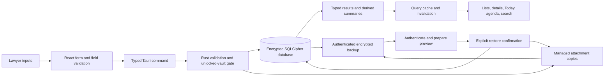

React uses narrow domain commands; it does not query the database or take arbitrary shell/filesystem/HTTP access. A successful mutation returns a DTO, then affected queries are refreshed. A refused mutation must retain the draft and leave persisted business records unchanged. Restore replaces the workspace and clears cached vault data.

| Relationship           | Implemented meaning                                                                                   | Consequence for outputs/testing                                                                                    |
| ---------------------- | ----------------------------------------------------------------------------------------------------- | ------------------------------------------------------------------------------------------------------------------ |
| Client ↔ case          | Many-to-many through `case_clients`; each case needs at least one distinct client                     | One client's page can show multiple cases; a case can show several clients, each with its own legal capacity/notes |
| Client ↔ POA           | A POA can contain several clients; a client can have historical archived POAs but only one active POA | Linking/restoring a conflicting active POA is refused                                                              |
| Case → POA             | Derived through the case's clients; no user-selected case POA pointer                                 | Case Parties must show the client's POA; prefer active POA, otherwise an archived one when available               |
| POA → cases            | Union of cases containing the POA's clients                                                           | A shared-client case must appear once, not once per matching client                                                |
| Case → opponents       | Lightweight case-owned opponent rows                                                                  | Opponents are not reusable clients or a global party directory                                                     |
| Case → hearings        | Each hearing has one case; a follow-up optionally points to its predecessor                           | Decision and follow-up insertion are transactional; follow-up becomes independently editable                       |
| Task → case/client     | Zero or one owner link: case **or** client **or** neither                                             | Client-filtered tasks include direct tasks plus tasks of the client's cases                                        |
| Payment → case + payer | Both required; payer must be a member of that case                                                    | A client receives only its own payer total, not all payments from every linked case                                |
| Expense → case/client  | Case **or** client **or** neither                                                                     | Client expense totals include direct expenses and the full expenses of every linked case                           |
| Case → fee agreement   | At most one agreement per case                                                                        | Saving again replaces the agreement value; fees are not per-client allocations                                     |
| Attachment → owner     | Exactly one client, case, POA, or expense                                                             | Managed copies are individually owned; linking entities does not automatically share their attachments             |

Date-only business values use `YYYY-MM-DD` without timezone conversion. Display preferences affect formatting, not the stored date. Hearing time is optional `HH:mm`; tasks have no time field. All money is integer EGP piasters (`amountMinor`): `1500.25 EGP → 150025`.

Source: [architecture](../plan/02-architecture.md), [case/POA link tests](../../src-tauri/tests/case_client_poa_links.rs), [query invalidation](../../src/lib/queryInvalidation.ts), [money parser](../../src/lib/money.ts), [date utilities](../../src/lib/dateOnly.ts).

## 3. Access, setup, recovery, and locking

| Form/control            | User inputs                                                                                         | Validation/defaults                                                                  | Stored effect and visible output                                                                                         |
| ----------------------- | --------------------------------------------------------------------------------------------------- | ------------------------------------------------------------------------------------ | ------------------------------------------------------------------------------------------------------------------------ |
| First-run setup         | Lawyer full name **required**; password **required**; confirmation **required**; language switch    | Trimmed nonempty name; password ≥12 characters; confirmation matches; Arabic/English | Creates local encrypted vault and lawyer profile; selected language is passed to initialization; shows recovery key once |
| Save recovery key step  | Saved-key acknowledgment **required** to continue; copy/save/print actions                          | Continue disabled until acknowledgment                                               | Displays key and storage instructions; acknowledgment is not a new client/domain record                                  |
| Unlock                  | Password **required**                                                                               | Nonempty in unlock form; actual authentication in Rust                               | Correct password opens workspace; wrong password shows refusal and keeps records locked                                  |
| Recover existing access | Recovery key **required**; new password **required**; matching confirmation **required**            | New password ≥12 characters; key authenticates existing vault                        | Rewraps access to the same vault; does not create business records or restore a backup                                   |
| Restore during setup    | Chosen backup; password or recovery key; recovery mode additionally needs new password/confirmation | See §13                                                                              | Authenticated preview precedes replacement; restored installation then requires unlock                                   |
| Lock application        | No data input                                                                                       | Explicit action or saved timeout                                                     | Workspace disappears; unlock gate replaces it; cached sensitive data is cleared by session handling                      |
| Password visibility     | Show/hide toggle                                                                                    | Visibility only                                                                      | Does not change password value or persistence                                                                            |

**Screenshots**

wrong-password refusal is specified by source/tests (no accepted screenshot in this run).

**setup**

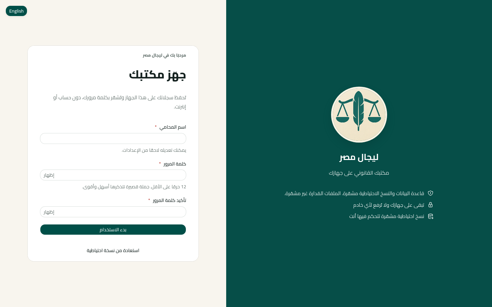

**required-field feedback**

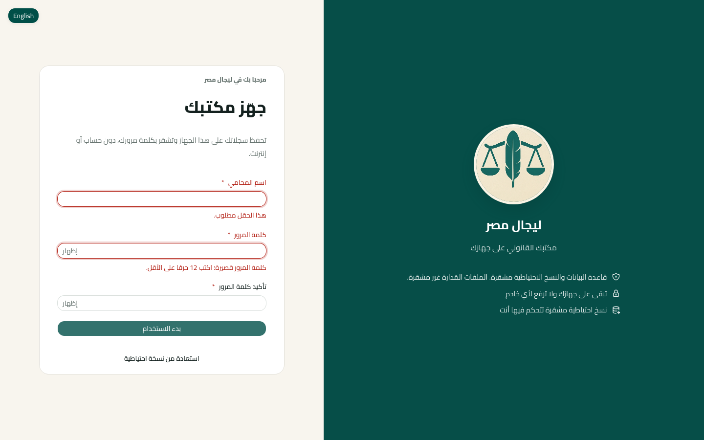

**redacted recovery key**

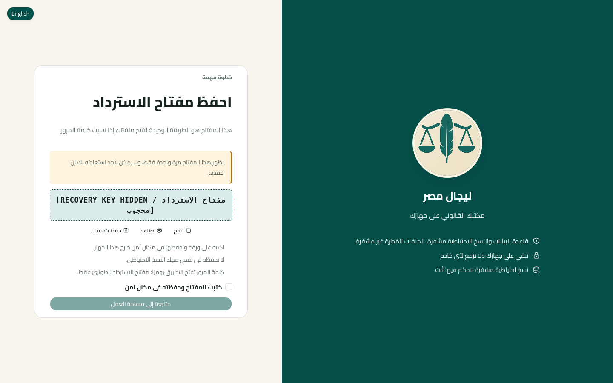

**unlock**

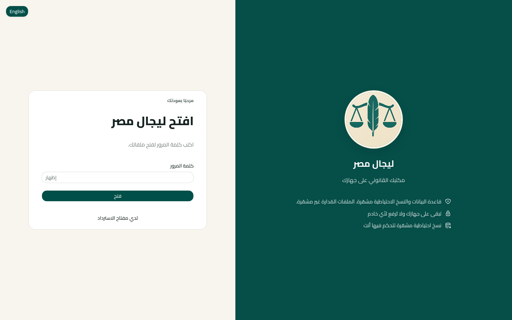

**recovery form**

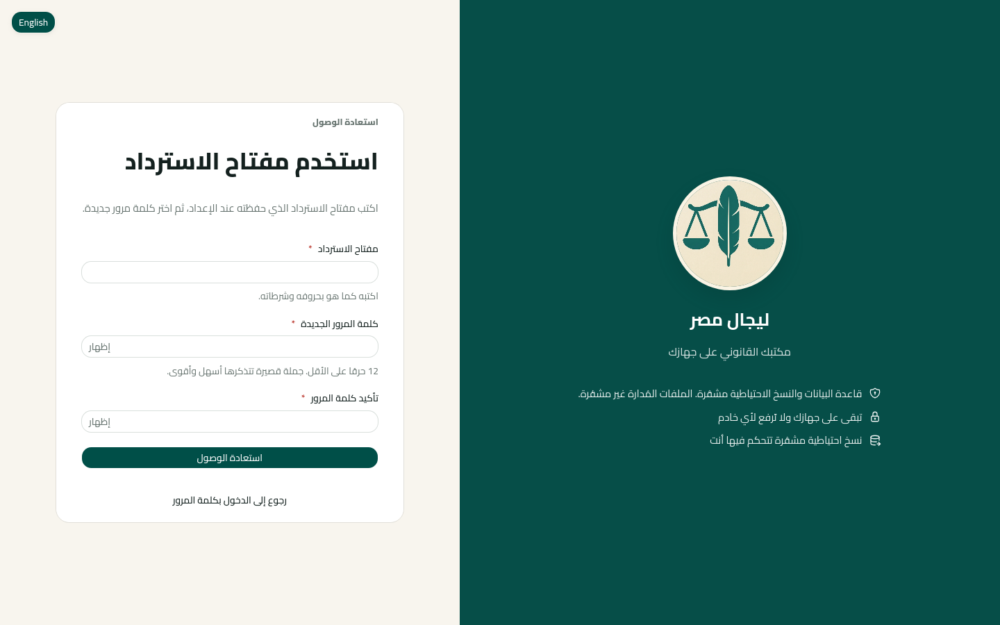

Startup also has a loading skeleton and error/incomplete/interrupted gate. The error gate displays the mapped refusal, Retry, and developer support contacts. An incomplete installation additionally offers Restore from backup; an interrupted operation does not offer replacement until recovered. These branches are documented from [App.tsx](../../src/app/App.tsx), without accepted screenshots in this run. No client/case content should appear before a usable unlocked session.

Normal tests must assert records survive lock/recovery/restart. Failure tests must assert no workspace on wrong password/key; mismatch/short password must not initialize/change access. Saving or printing a recovery key is a native OS action and needs separate platform evidence.

Source: [OnboardingPage](../../src/features/onboarding/pages/OnboardingPage.tsx), [onboarding schema](../../src/features/onboarding/schemas/onboarding.schema.ts), [app service](../../src-tauri/src/services/app_service.rs).

## 4. Clients

### 4.1 Create and edit inputs

Entry points: Clients → Add client; quick-add; inline client creation from case/POA forms. Edit: client detail → Edit.

| Visible input          | Payload field      | Required/default                             | Rules and create/edit distinction                                                                                    |
| ---------------------- | ------------------ | -------------------------------------------- | -------------------------------------------------------------------------------------------------------------------- |
| Internal client number | `internalNumber`   | **Required**; create can suggest next number | Trimmed, unique; suggestion editable and must not overwrite an already typed number; Arabic digits normalized        |
| Full name              | `fullName`         | **Required**                                 | Nonempty after trimming; may match another client's name                                                             |
| National ID            | `nationalId`       | Optional                                     | Text; digit normalization; no implemented 14-digit/official-ID verification                                          |
| Primary phone          | `primaryPhone`     | Optional                                     | Text; Arabic digits normalized; normalized phone used for probable duplicates/search                                 |
| Email                  | `email`            | Optional                                     | Text; schema does not validate email syntax                                                                          |
| Address                | `address`          | Optional                                     | Free text                                                                                                            |
| Notes                  | `notes`            | Optional                                     | Free text, multiline                                                                                                 |
| Duplicate confirmation | `confirmDuplicate` | Create-only, initially false                 | Probable matching name/phone triggers warning; explicit proceed required; does not bypass internal-number uniqueness |

Edit uses the same visible fields, prefilled from the record, adds hidden `id`, and does not submit the create-only duplicate confirmation. The client form does **not** select a case, POA, balance, client type, gender, birth date, or nationality. Those are not current inputs.

Inline create saves the client independently, selects it in the parent draft, and leaves the parent form open. Canceling the parent after a successful inline save does not imply the new client is rolled back. Test that lifecycle explicitly.

**Screenshots**

**create**

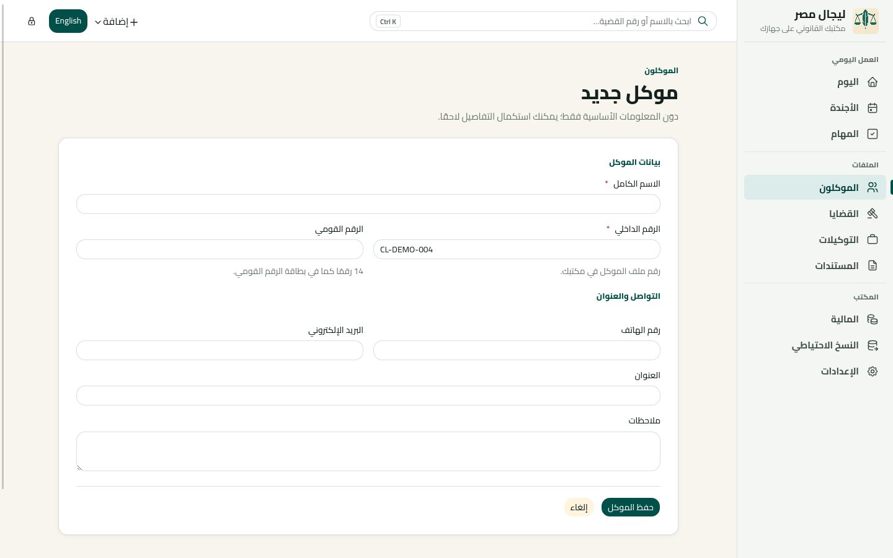

**edit**

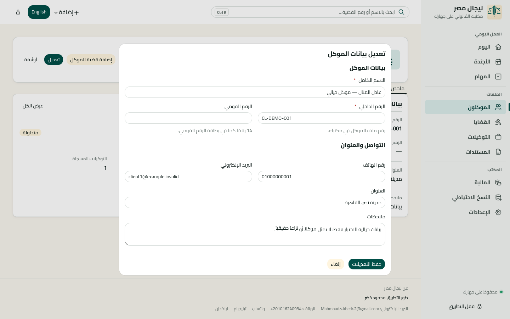

**required feedback**

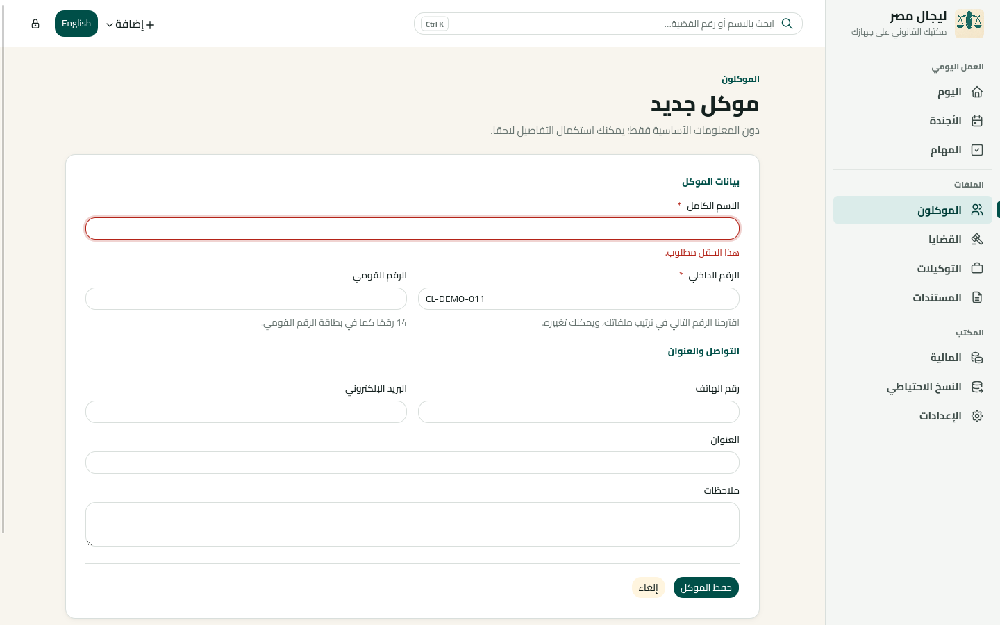

**duplicate warning**

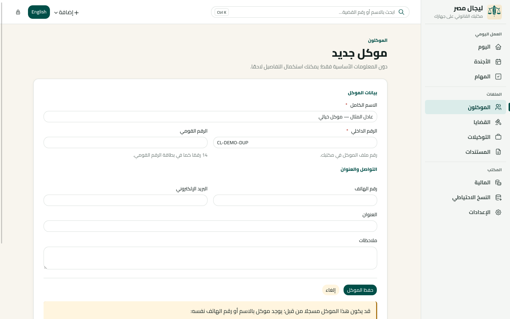

**inline create**

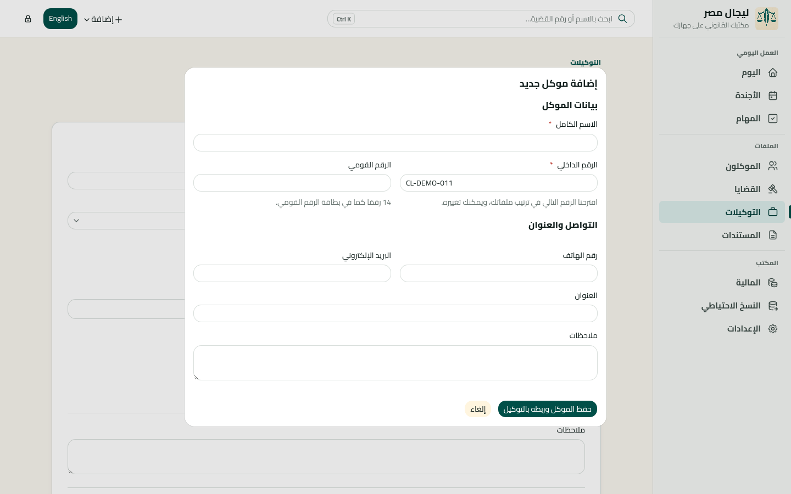

### 4.2 Client outputs

| View                   | What user sees                                                                                                  | Data source / caveat                                                              |
| ---------------------- | --------------------------------------------------------------------------------------------------------------- | --------------------------------------------------------------------------------- |
| Clients list           | Name linked to detail; internal number; phone or dash; active/archived badge                                    | `client_list`; search text and Show archived; default excludes archived clients   |
| Detail header          | Name/initial; internal number; optional phone with copy action; archived badge; Edit, Archive/Restore, New case | New case omitted when archived; Edit remains available even on archived clients   |
| Summary → contact      | Internal number, phone, national ID, email, address; notes when present                                         | `client_get`; empty facts use placeholder                                         |
| Summary → linked cases | First four returned linked cases: internal number, optional official reference, status; View all                | `case_list({clientId})`; default excludes archived cases                          |
| Summary → indicators   | Received amount and POA count                                                                                   | Received is payments whose payer is this client; POA count includes archived POAs |
| Cases tab              | All returned linked case internal numbers, official references/absence message, status; New case shortcut       | Archived cases are not requested by this page                                     |
| POAs tab               | Linked POA title, official number/absence message, archived badge, link to POA and management                   | `power_of_attorney_list({clientId,includeArchived:true})`; includes history       |
| Account tab            | Received, expenses, net cash; explanatory note; Open ledger                                                     | No agreed fee or outstanding balance on client account; formulas in §9            |
| Attachments tab        | Only client-owned files with file metadata and actions                                                          | Does not include attachments of the client's cases or POAs                        |

**Screenshots**

**list**

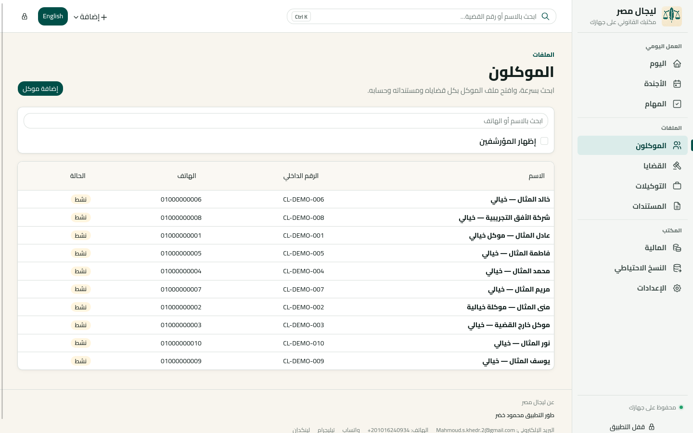

**summary**

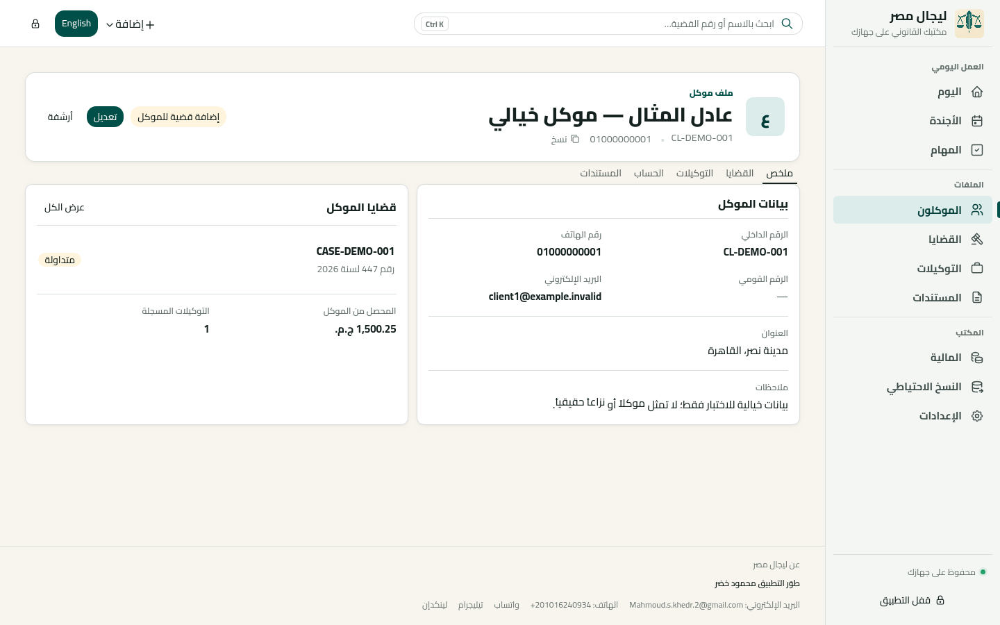

**cases**

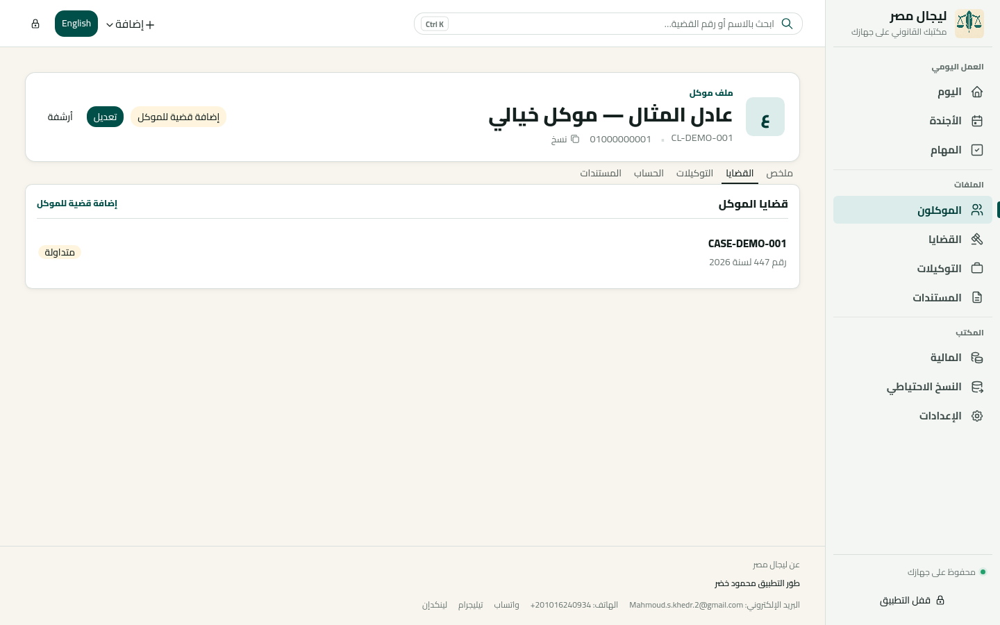

**POAs**

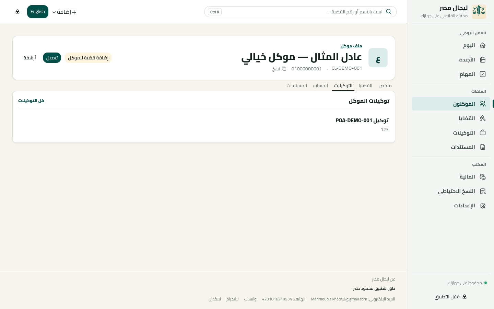

**account**

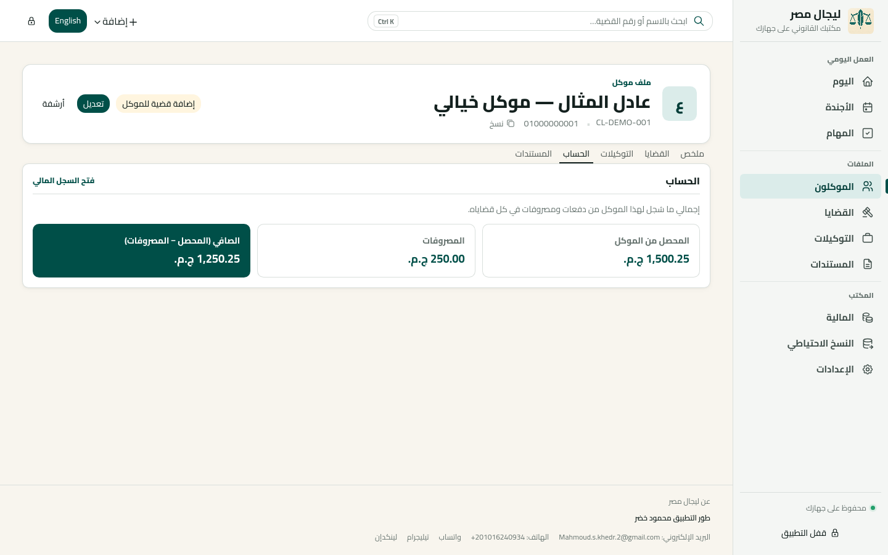

**attachments**

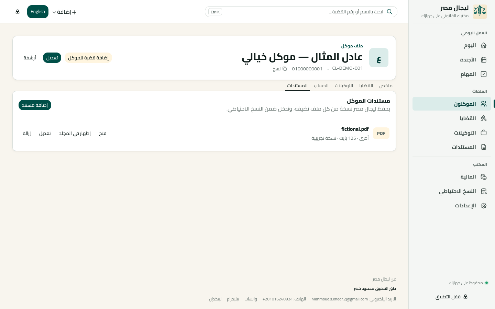

### 4.3 Client flow and acceptance

Create → `client_create` → insert client and search entry transactionally → open client detail. Edit → `client_update` → update client and rebuild dependent search text → refresh client queries. Archive is a confirmation, not deletion; restore preserves identity and internal number.

Required assertions: every optional field round-trips; edit clearing is reflected after reopen/restart; rejected duplicate number retains draft; duplicate warning requires explicit confirmation; selecting client on a new case produces reciprocal case link; linking POA appears in POA tab and case Parties; phone copy reports clipboard failure. Client detail currently has **no Tasks tab**, although global Tasks can filter by client.

Source: [ClientForm](../../src/features/clients/forms/ClientForm.tsx), [schema](../../src/features/clients/schemas/client.schema.ts), [ClientDetailPage](../../src/features/clients/pages/ClientDetailPage.tsx), [NewClientPage](../../src/features/clients/pages/NewClientPage.tsx), [client service](../../src-tauri/src/services/client_service.rs).

## 5. Powers of attorney

### 5.1 Create/edit inputs

Create is a full page `/powers-of-attorney/new`; edit is a populated dialog on POA detail.

| Visible input       | Payload                 | Required/default                  | Rules                                                                                                         |
| ------------------- | ----------------------- | --------------------------------- | ------------------------------------------------------------------------------------------------------------- |
| Internal sequence   | `internalSequence`      | **Required**, suggested on create | Unique across active/archived records; digit normalization                                                    |
| Official POA number | `officialNumber`        | Optional                          | Not unique; repeated official numbers are allowed                                                             |
| Issue date          | `issueDate`             | Optional date-only                | Calendar/typed date; determines `issueYear` from first four date digits                                       |
| Notary office       | `notaryOffice`          | Optional                          | Free text with existing-record suggestions                                                                    |
| Notes               | `notes`                 | Optional                          | Free text                                                                                                     |
| Linked clients      | `clientIds[]`           | **At least one required**         | Distinct existing IDs; archived clients cannot be newly selected; clients holding another active POA disabled |
| Add client inline   | Independent client form | Same as §4                        | Successfully created client auto-selected in POA draft                                                        |
| Named lawyers       | `lawyers[]`             | Zero or more rows                 | Each added row requires nonblank full name; optional bar number and notes; rows removable                     |

`issueYear` is derived, not a separate field. Lawyer rows are descriptive POA-owned records, not user accounts or assignment permissions. Edit retains existing lawyer IDs; no case selector appears in this form.

### 5.2 Outputs and flow

| View          | Visible output                                                                                                                            |
| ------------- | ----------------------------------------------------------------------------------------------------------------------------------------- |
| POA list      | Internal sequence with detail link; official number or dash; linked client names; active/archived badge; query and Show archived controls |
| Header        | Internal sequence; POA identity/context; archived status; Edit and Archive/Restore                                                        |
| Summary       | Official number, issue year/date, notary office, optional notes; linked client names/internal numbers                                     |
| Clients tab   | Client names/internal numbers and detail links                                                                                            |
| Lawyers tab   | Lawyer full name, bar number or absence message, notes                                                                                    |
| Cases tab     | Derived unique case links with internal number, court/client context and case status when available                                       |
| Documents tab | Only POA-owned attachments                                                                                                                |

Save → `power_of_attorney_create/update` → POA, client links and descriptive lawyers → search refresh → POA/client/case dependent queries. Archive frees the active-POA constraint but preserves history. Restore is refused if one of its clients now belongs to another active POA.

**Screenshots**

**list**

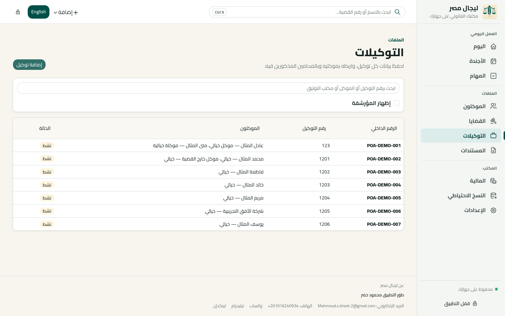

**create**

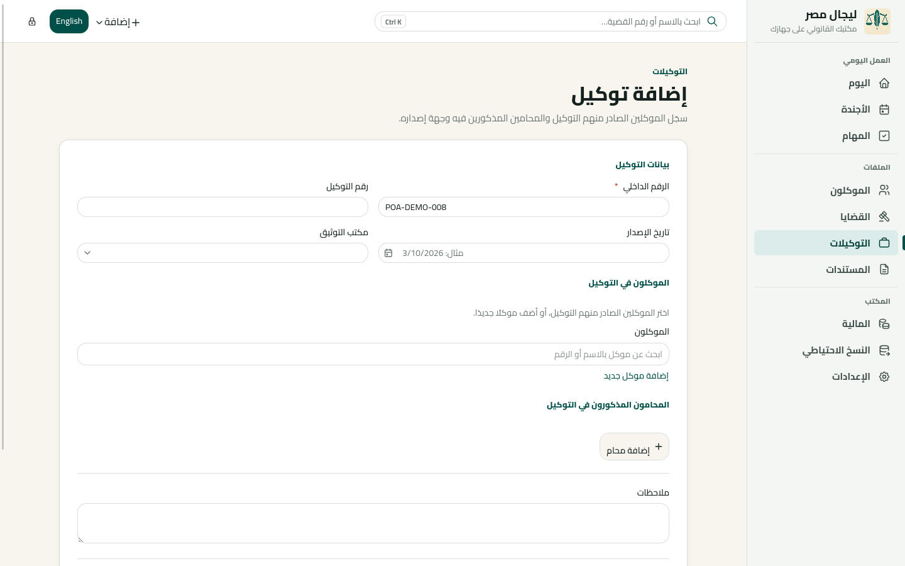

**edit**

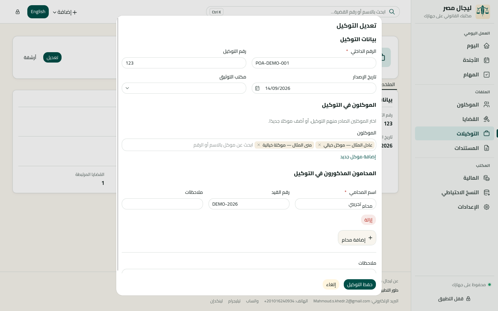

**summary**

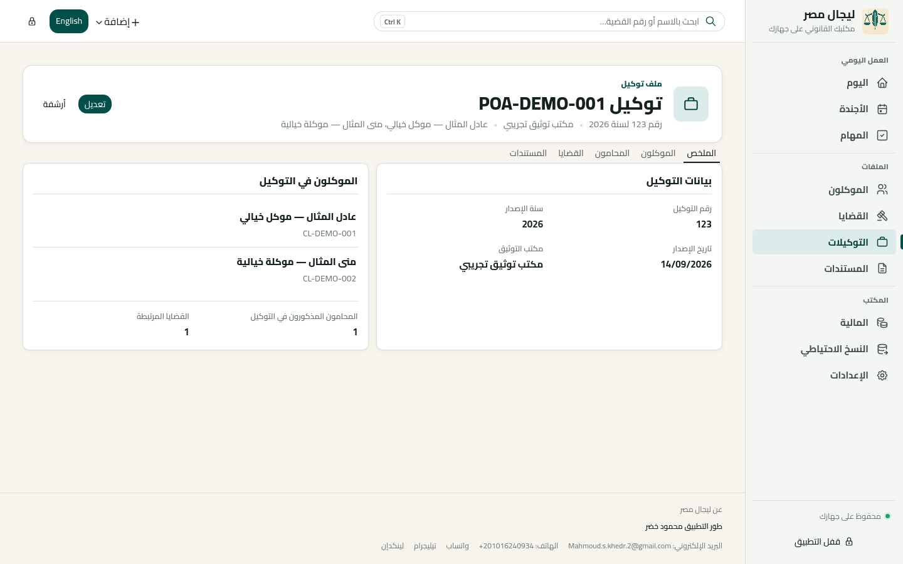

**clients**

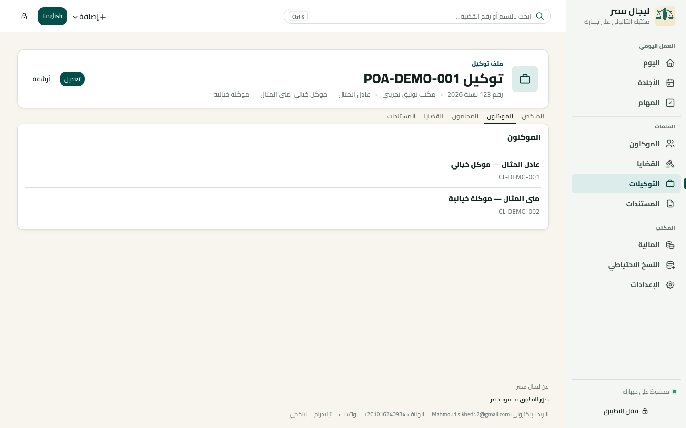

**lawyers**

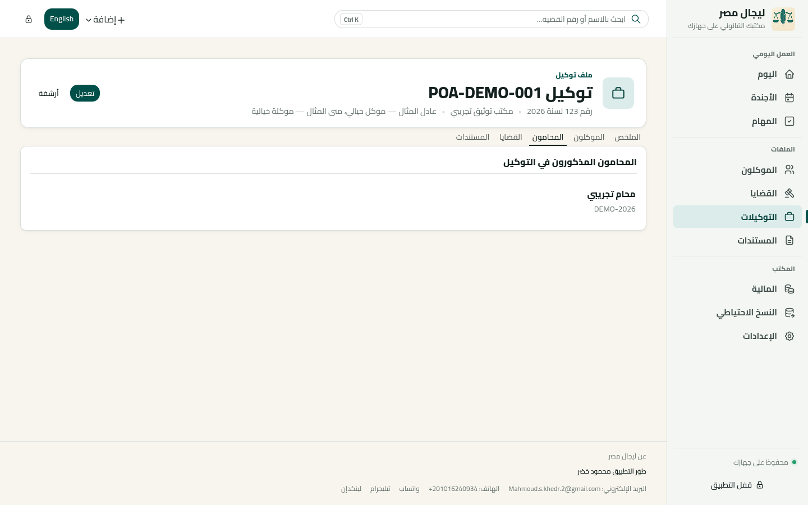

**cases**

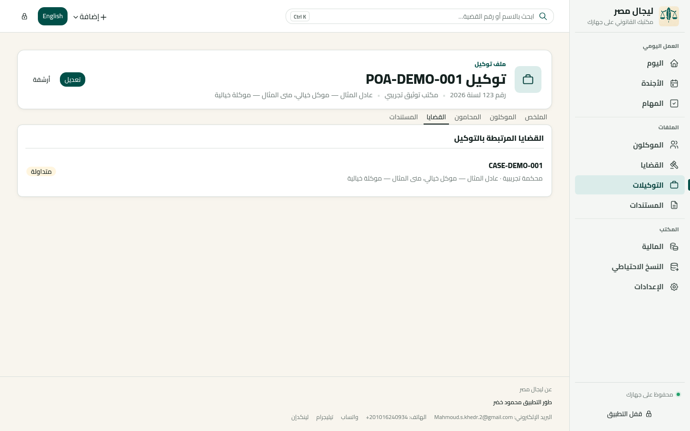

**documents**

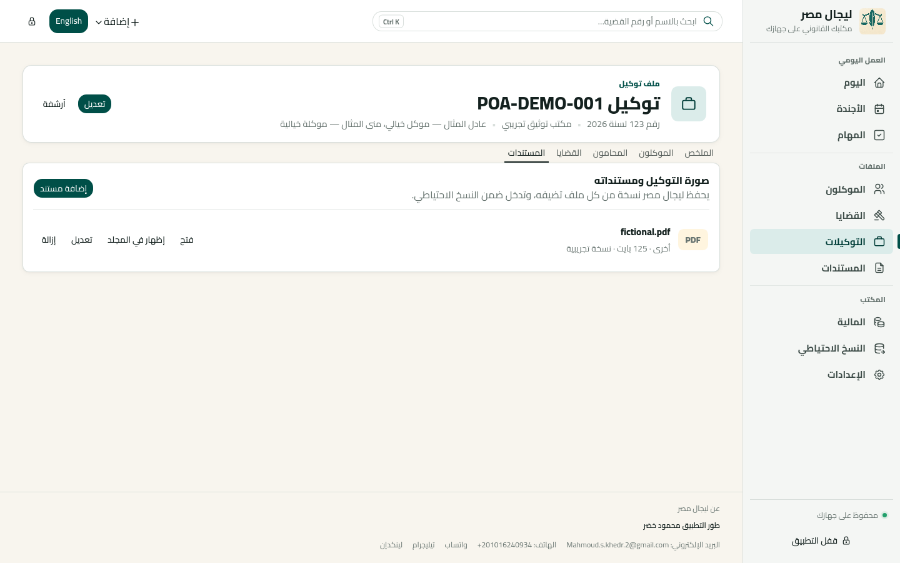

Assertions: no-client save fails; each lawyer name required if row exists; duplicate internal sequence fails while repeated official number succeeds; shared-client case displayed once; active/historical POA badges correct; edits changing membership refresh former and new dependents; inline cancel/failure retains parent draft.

Source: [POA form](../../src/features/powersOfAttorney/components/PowerOfAttorneyForm.tsx), [POA detail](../../src/features/powersOfAttorney/pages/PowerOfAttorneyDetailPage.tsx), [POA service](../../src-tauri/src/services/power_of_attorney_service.rs), [POA repository](../../src-tauri/src/repositories/power_of_attorney_repository.rs).

## 6. Cases, clients in a case, and opponents

### 6.1 Case create/core-edit inputs

| Visible input        | Payload                                                   | Required/default                    | Rules                                                                                                                |
| -------------------- | --------------------------------------------------------- | ----------------------------------- | -------------------------------------------------------------------------------------------------------------------- |
| Internal case number | `internalNumber`                                          | **Required**, suggestion on create  | Unique; editable suggestion                                                                                          |
| Official case number | `officialNumber`                                          | Optional unless a year supplied     | Text; not the internal identifier                                                                                    |
| Official year        | `officialYear`                                            | Optional                            | Gregorian year, integer 1800–9999; requires official number in renderer                                              |
| Judicial year        | `judicialYear`                                            | Optional                            | Court year, integer 1–9999; requires official number in renderer; not interchangeable with official year             |
| Status               | `status`                                                  | `ACTIVE` default                    | `ACTIVE`, `SUSPENDED`, `CLOSED`; distinct from archived flag                                                         |
| Court                | `courtName`                                               | Optional                            | Free-text suggestion combobox                                                                                        |
| Circuit              | `circuitName`                                             | Optional                            | Free-text suggestion combobox                                                                                        |
| Case type            | `caseType`                                                | Optional                            | Free-text suggestion combobox                                                                                        |
| Litigation degree    | `litigationDegree`                                        | Optional                            | `FIRST_INSTANCE`, `APPEAL`, `CASSATION`, `OTHER`                                                                     |
| Filing date          | `filedOn`                                                 | Optional                            | Valid date-only                                                                                                      |
| Closing date         | `closedOn`                                                | Optional                            | Valid date-only; renderer rejects earlier than filing                                                                |
| Subject / summary    | `subject`                                                 | Optional                            | Multiline free text                                                                                                  |
| Notes                | `notes`                                                   | Optional                            | Multiline free text                                                                                                  |
| Linked clients       | Create form `clientIds[]` → payload `clients[{clientId}]` | **At least one required on create** | Existing active clients; multi-picker searches names/numbers/phones; new client inline; `?client=` preselects client |

**Core edit has no client picker.** It edits case fields and submits existing relationship metadata unchanged. Membership/capacity/notes are edited in the separate Parties editor. No global case capacity or per-case POA selector exists.

### 6.2 Clients-in-case relationship editor

| Input/context               | Rule                                                | Output                                                               |
| --------------------------- | --------------------------------------------------- | -------------------------------------------------------------------- |
| Selected clients            | At least one, distinct IDs                          | Replaces case membership via `case_set_clients`                      |
| Per-client legal capacity   | Optional free text with suggestions                 | Shown alongside that client in Parties                               |
| Per-client notes            | Optional multiline text                             | Stored and prefilled on reopen; not displayed in normal Parties rows |
| Existing archived selection | Retained and visible; new archived clients disabled | Allows preserving historical relationships                           |
| Client's POA                | Derived output on normal Parties view               | Link and archived badge, or no-POA message; not editable here        |

Removing a client who has payments in the case fails with `CASE_CLIENT_HAS_PAYMENTS`. The operation must leave relationships and search index unchanged. This editor does not modify court, status, subject, or other case core data.

### 6.3 Opponent create/edit inputs

Full name **required**; optional legal capacity, lawyer name, phone, address, notes. `caseId` comes from the owning case on create; `id` comes from the selected opponent on edit. These rows have no link to a client record or POA. Remove requires explicit confirmation; cancel preserves opponent.

### 6.4 Case outputs

| View                      | Visible output and meaning                                                                                                                                                                                                   |
| ------------------------- | ---------------------------------------------------------------------------------------------------------------------------------------------------------------------------------------------------------------------------- |
| Cases list                | Internal number/link, official reference combining number and years, client names, court, earliest scheduled hearing date, status; overdue pending decision label; query/status/archive filters                              |
| Detail header             | Internal number, status/archived badge, official reference, court, linked client names; Edit or Restore/Archive                                                                                                              |
| Summary                   | Internal/official references, type, degree, court, circuit, filing/closing dates, subject, optional notes                                                                                                                    |
| Summary → next event      | Earliest scheduled hearing, including past hearings still awaiting decision; date/time or all-day, type/location/circuit, required documents; edit/decision controls when permitted                                          |
| Summary → latest decision | Most recent date-sorted hearing with nonempty decision text                                                                                                                                                                  |
| Summary → account/tasks   | Agreed fee, received, outstanding, number of incomplete tasks                                                                                                                                                                |
| Parties → clients         | Client name/link, internal number, capacity, derived POA link/archive marker or absence message                                                                                                                              |
| Parties → opponents       | Opponent name, capacity, lawyer/phone context; edit/remove actions. Additional address/notes are accessible in edit form rather than a complete standalone opponent detail view                                              |
| Hearings                  | Newest-first timeline: date, time or weekday, type/status, location/circuit, decision text; scheduled hearing edit/decision actions                                                                                          |
| Tasks                     | Incomplete tasks first, then due date; title, due date, overdue/completed marker; details/notes accessible in editor; completion/reopen and edit; case-scoped create                                                         |
| Attachments               | Only case-owned documents; open/reveal remain available when archived                                                                                                                                                        |
| Account                   | Four totals: agreed, received, outstanding, expenses; fee amount editor; payments with date/payer/amount and expenses with date/type/notes/amount; inspection/edit actions. Case net cash exists in DTO but is not displayed |
| Archived case             | Read-only notice; mutation controls hidden/disabled until restored, including global task/finance/document contexts                                                                                                          |

Case status `CLOSED` alone is not archiving. Read-only enforcement is based on `archivedAt`, in both React and Rust.

**Screenshots**

**case create**

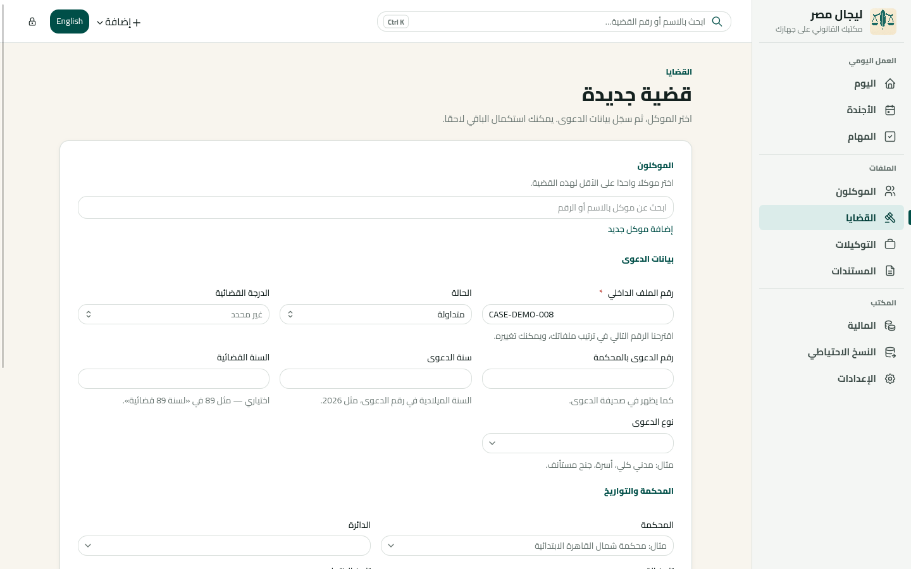

**core edit**

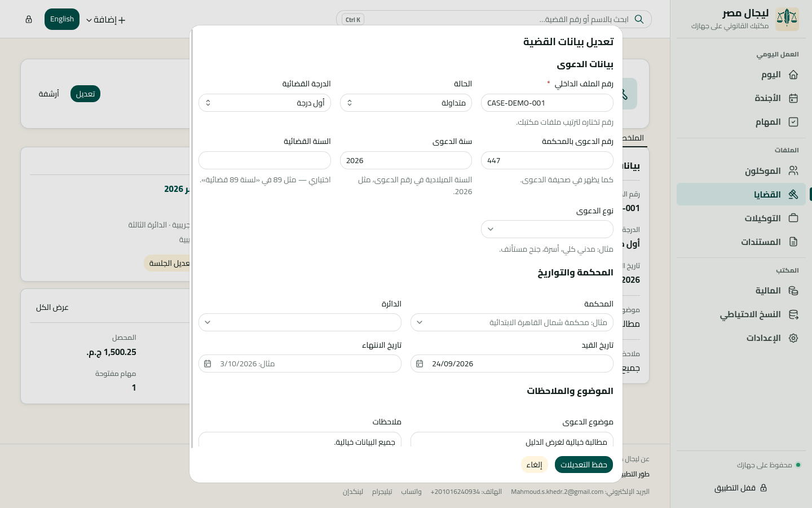

**relationship editor**

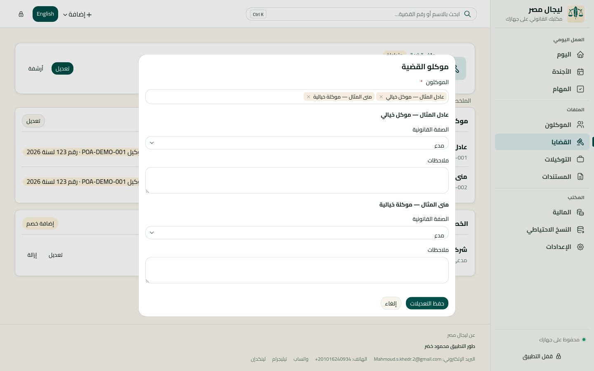

**opponent create**

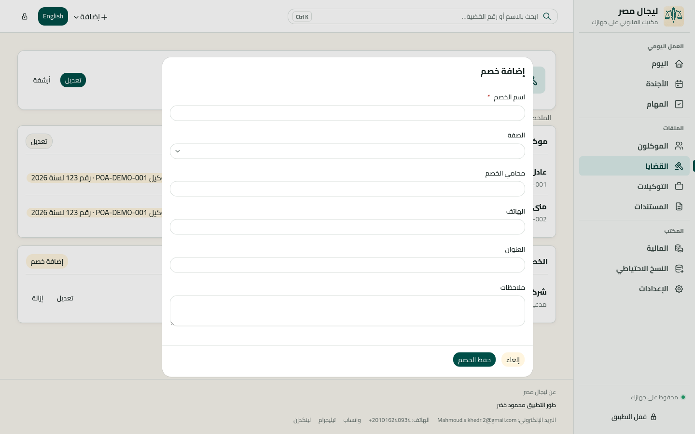

**opponent edit**

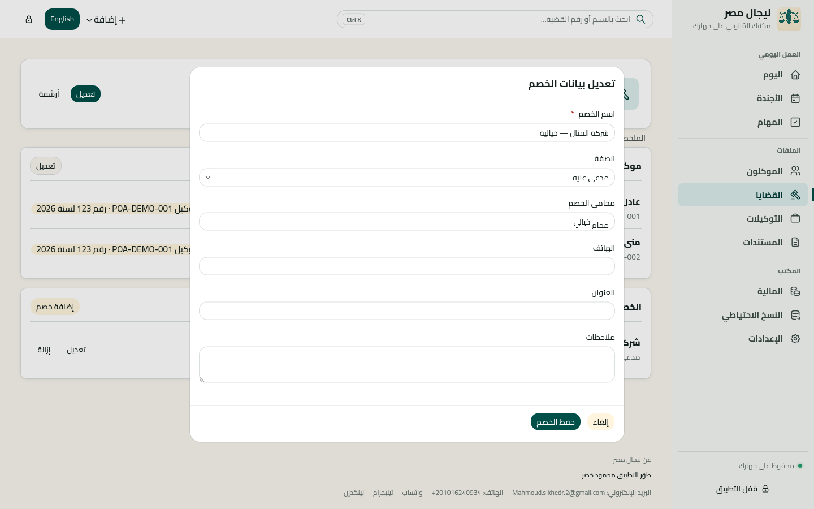

**list**

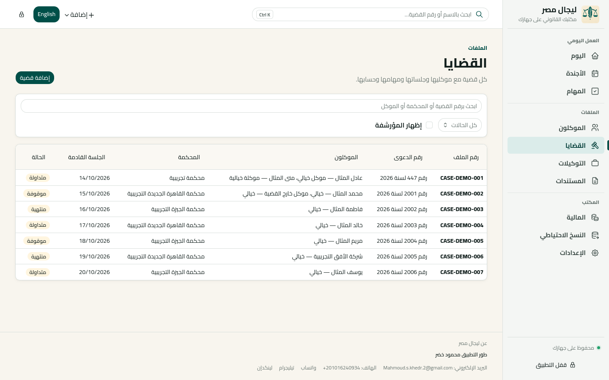

**summary**

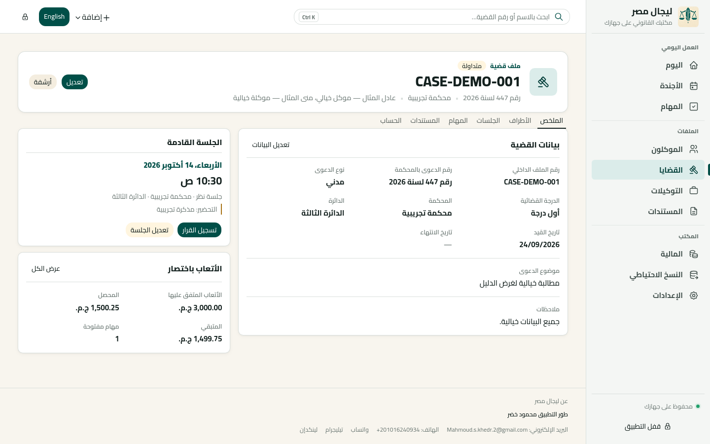

**Parties**

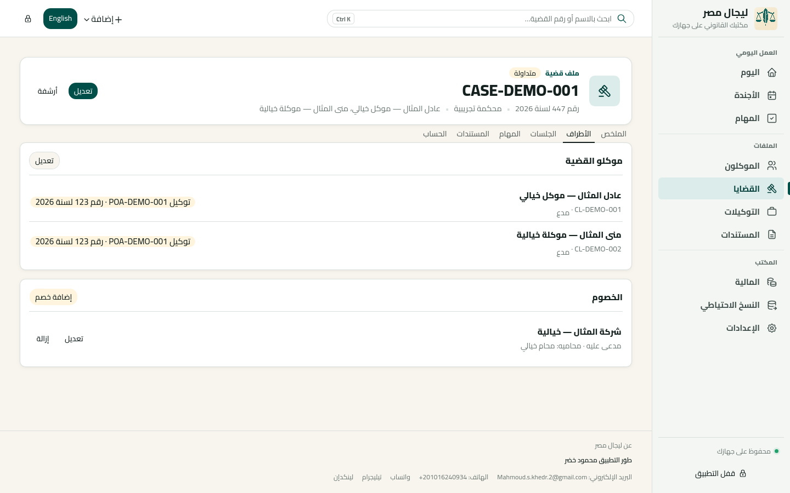

**hearings**

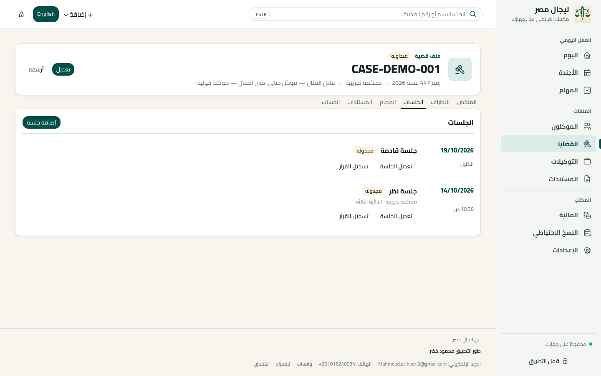

**tasks**

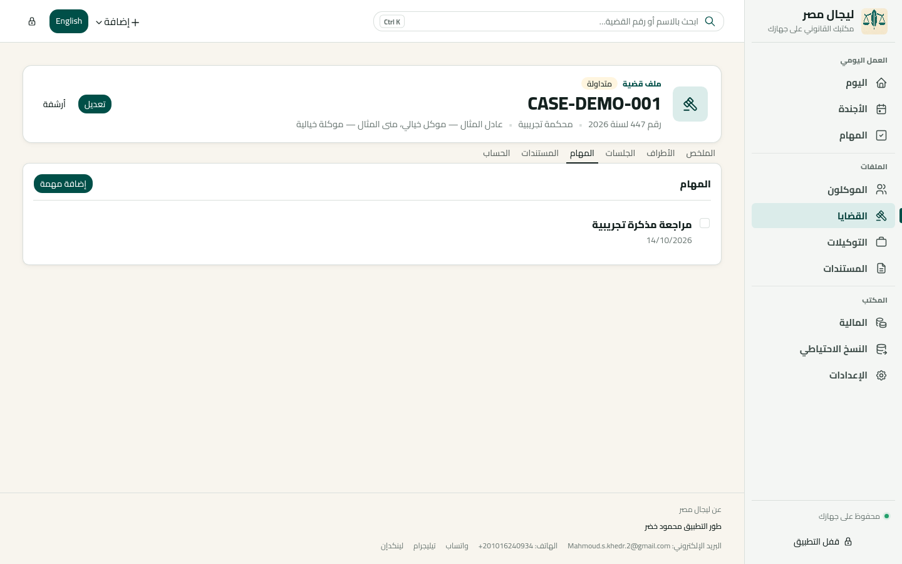

**documents**

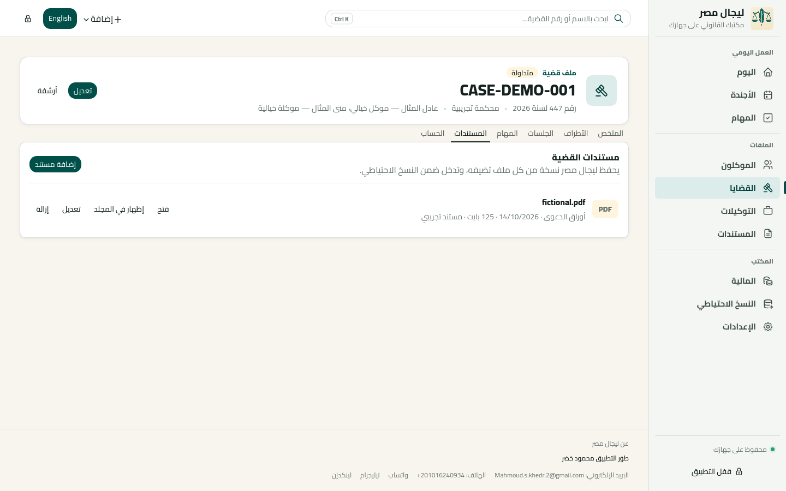

**account**

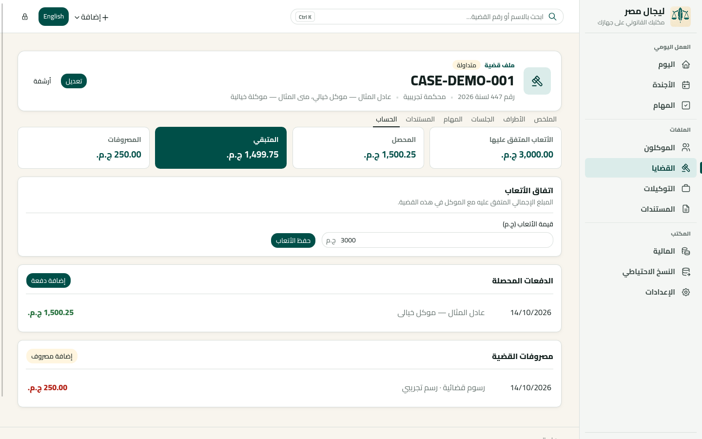

**archived**

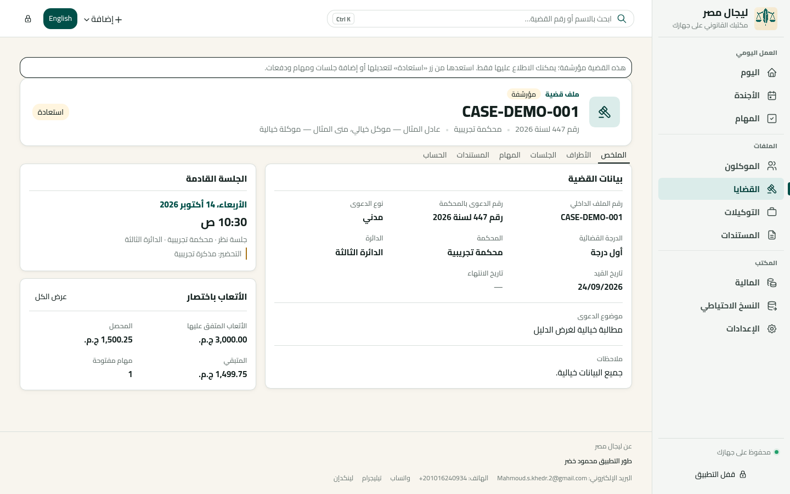

Source: [case schemas](../../src/features/cases/schemas/case.schema.ts), [core fields](../../src/features/cases/forms/CaseCoreFields.tsx), [create](../../src/features/cases/forms/CaseCreateForm.tsx), [edit](../../src/features/cases/forms/CaseEditForm.tsx), [relationship editor](../../src/features/cases/components/CaseClientsPanel.tsx), [opponents](../../src/features/cases/components/CasePartiesPanel.tsx), [detail](../../src/features/cases/pages/CaseDetailPage.tsx), [case service](../../src-tauri/src/services/case_service.rs).

## 7. Hearings and agenda

### 7.1 Hearing create/edit inputs

| Input              | Payload                     | Required/default                                | Behavior                                                                |
| ------------------ | --------------------------- | ----------------------------------------------- | ----------------------------------------------------------------------- |
| Case               | `caseId`                    | **Required**; supplied by case page when scoped | Active case choices; edit retains source case and prevents reassignment |
| Date               | `hearingDate` (form `date`) | **Required**; today/selected day default        | Valid date-only                                                         |
| Time               | `hearingTime` (form `time`) | Optional                                        | Normalized `HH:mm`; 15-minute suggestions but exact times accepted      |
| Hearing type       | `hearingType`               | Optional                                        | Free-text suggestions                                                   |
| Location/court     | `location`                  | Optional                                        | New form can prefill from chosen case                                   |
| Circuit            | `circuitName`               | Optional                                        | New form can prefill from chosen case                                   |
| Required documents | `requiredDocuments`         | Optional                                        | Multiline preparation text; does not attach files                       |
| Notes              | `notes`                     | Optional                                        | Multiline text                                                          |

New hearing status is `SCHEDULED`; status, completed timestamp, and predecessor ID are not form inputs. Rust refuses edits to nonscheduled hearings or changes of case. Archive checks apply to both original and proposed case.

### 7.2 Decision inputs and derived output

Decision text optional; next-hearing date optional. Recording a decision marks source hearing completed even if both are omitted. If next date is supplied, the app sends a new hearing using the same case, time, type, location, circuit, and required documents; **notes are not copied**. The new hearing is scheduled with `previousHearingId` referring to the source. Both writes commit together.

A next date on/before the source date currently displays a hint; it is **not a blocking validation rule** in the form or service. Do not write a test expecting refusal unless the product rule is intentionally changed.

### 7.3 Agenda outputs

| View/control            | Output                                                                                                                                                        |
| ----------------------- | ------------------------------------------------------------------------------------------------------------------------------------------------------------- |
| Month                   | Calendar grid, selected day, hearing/task entries grouped by date; today/selection markers                                                                    |
| Week                    | Seven days from configured week start, with hearing times/case/location and task titles                                                                       |
| List                    | Dated records starting today by default; Show past toggles earlier dates; entries sorted by date                                                              |
| Day detail → hearing    | Date/time, case/client context, type/status, court/circuit, required documents, notes, decision where available; case link and permitted edit/decision/delete |
| Day detail → task       | Due task title, completion state, case/client context and details; task navigation/create context                                                             |
| Period controls         | Previous/next period, Today, month/week/list choice; view changes do not mutate records                                                                       |
| Deep link `?hearing=id` | Opens that exact hearing; unavailable ID reports absence instead of another hearing                                                                           |

Case Hearings tab is a compact output, not a full substitute for the hearing editor/day detail. Delete hearing requires confirmation and respects predecessor/reference integrity; canceled confirmation must not delete. There is no hearing-roll print control, reminder setting, or cancellation workflow, despite `CANCELLED` existing in DTO status types.

**Screenshots**

**month**

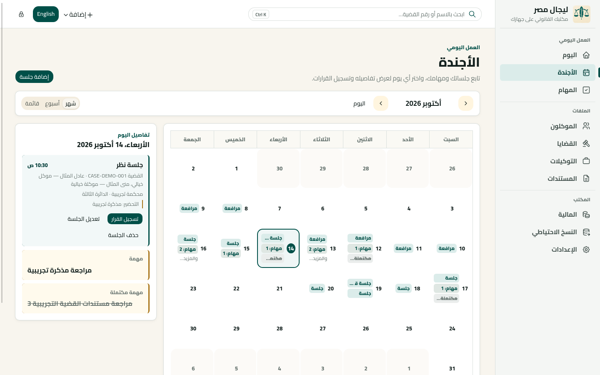

**week**

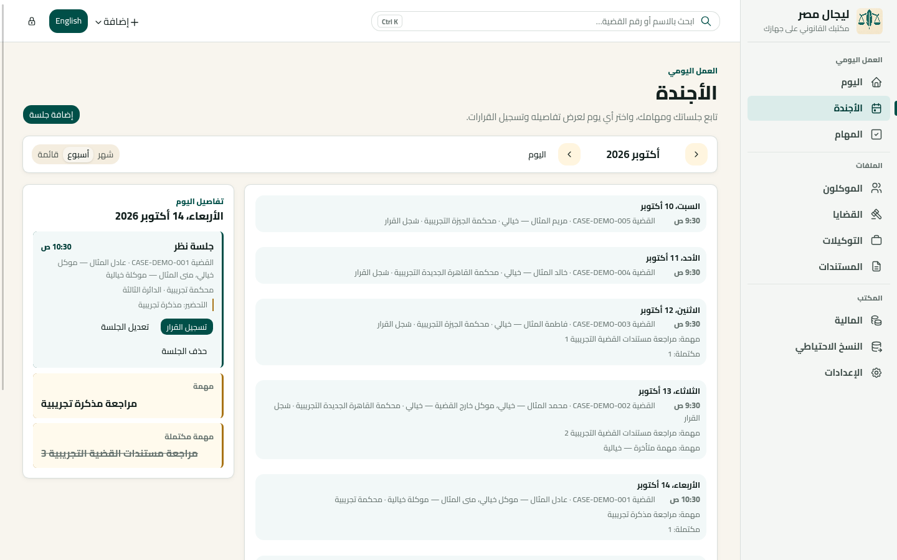

**list**

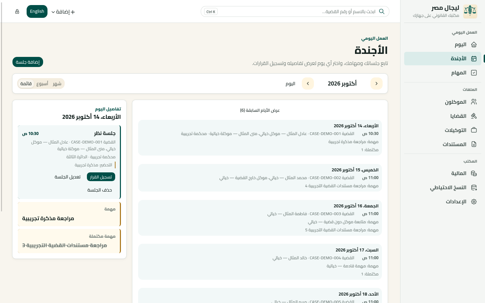

**create**

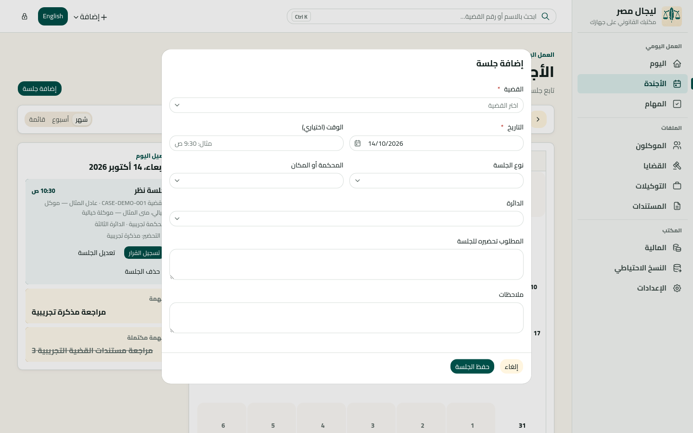

**edit**

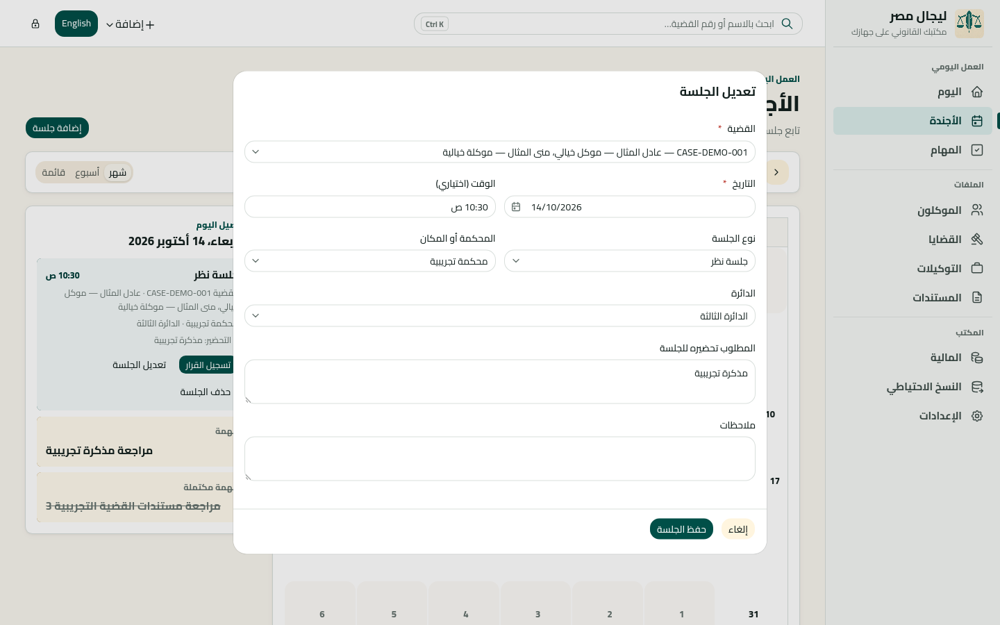

**decision**

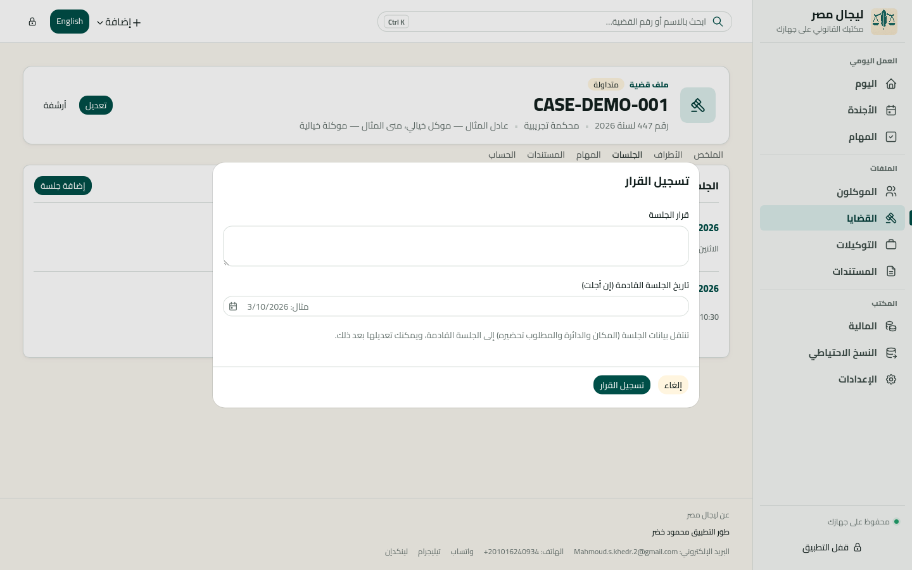

**delete confirmation**

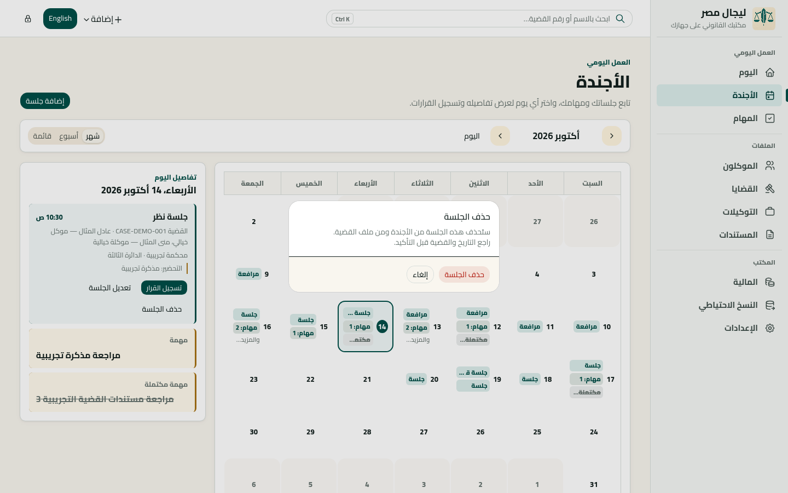

Source: [AgendaPage and shared forms](../../src/features/hearings/pages/AgendaPage.tsx), [hearing service](../../src-tauri/src/services/hearing_service.rs), [hearing repository](../../src-tauri/src/repositories/hearing_repository.rs).

## 8. Tasks

### 8.1 Inputs

| Visible input   | Payload            | Required/default                      | Rules                                                                              |
| --------------- | ------------------ | ------------------------------------- | ---------------------------------------------------------------------------------- |
| Title           | `title`            | **Required**                          | Trimmed nonblank                                                                   |
| Due date        | `dueDate`          | **Required**; today or create context | Date-only; no time                                                                 |
| Case            | `caseId`           | Optional                              | Selecting case clears/disables client link; linked case's clients shown as context |
| Client          | `clientId`         | Optional                              | Direct client link when no case; neither link is allowed                           |
| Details         | `details`          | Optional                              | Multiline text                                                                     |
| Notes           | `notes`            | Optional                              | Multiline text                                                                     |
| Complete/reopen | Command using `id` | Separate checkbox action              | Writes completed flag/timestamp; not part of normal text form                      |

Create and edit share the form; edit adds `id` and preloads all fields. Tasks have no priority, assignee, reminder, canceled status, recurrence, attachment owner, or source-hearing input.

### 8.2 Outputs and derived views

Rows display completion checkbox, title/edit action, due date, case number or direct client name, details when present, derived status badge, Delete. Notes are present in the editor, not normal task rows. Archived-case task actions are disabled.

| View      | Exact predicate relative to today's date |
| --------- | ---------------------------------------- |
| Today     | Incomplete and due date equals today     |
| Overdue   | Incomplete and due date before today     |
| Upcoming  | Incomplete and due date after today      |
| Completed | Completed, irrespective of due date      |
| All       | All task records matching owner filters  |

Case filter uses exact case ownership. Client filter includes directly owned tasks plus tasks of all that client's cases. Both list filters may be combined; this does not mean a task stores both links. Global task count is current filtered count. Deep link `?task=id` must open exact record or report unavailable; `?create=task` and context date/case/client seed new form.

Save/completion/reopen/delete refresh Tasks, Today and Agenda. Delete requires confirmation; refusal preserves task and draft/confirmation state.

**Screenshots**

**create**

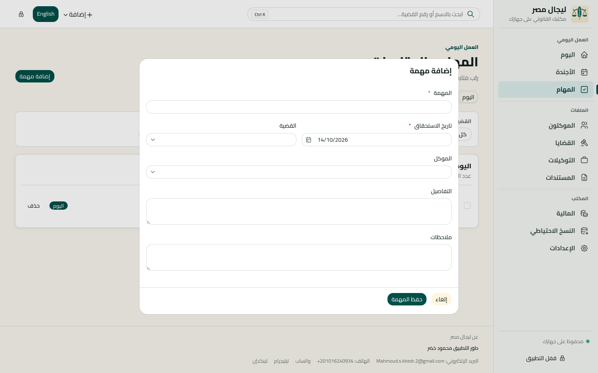

**edit**

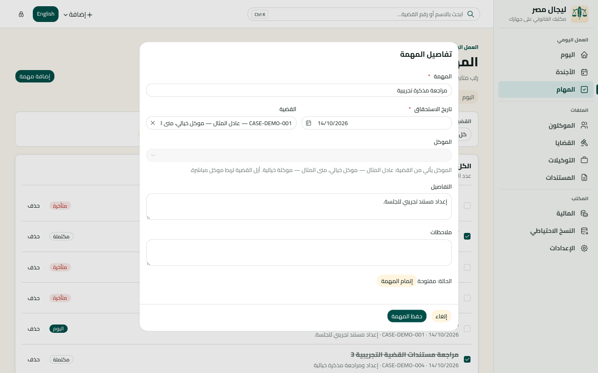

**Today**

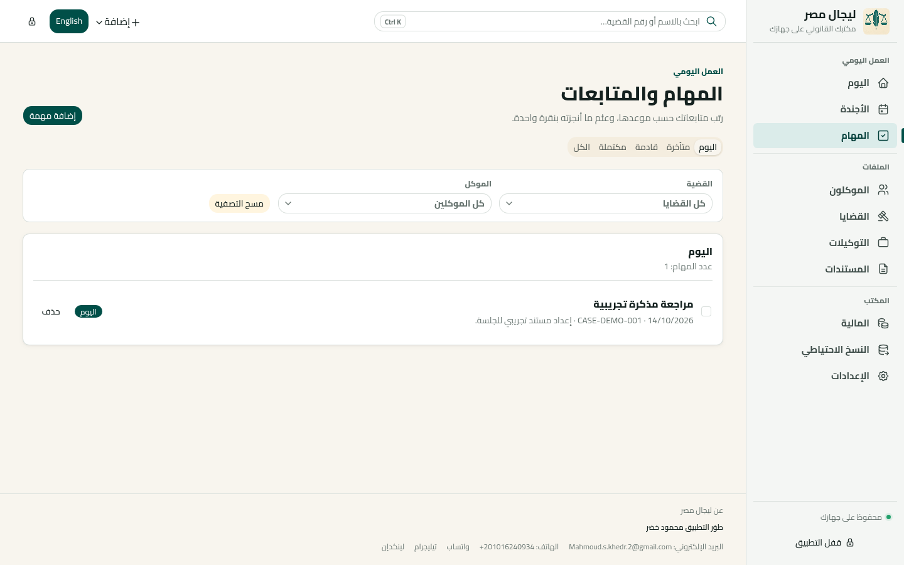

**Overdue**

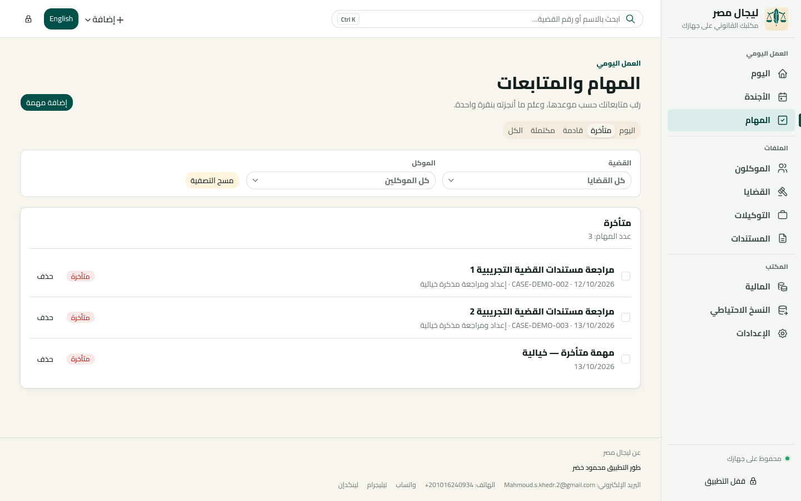

**Upcoming**

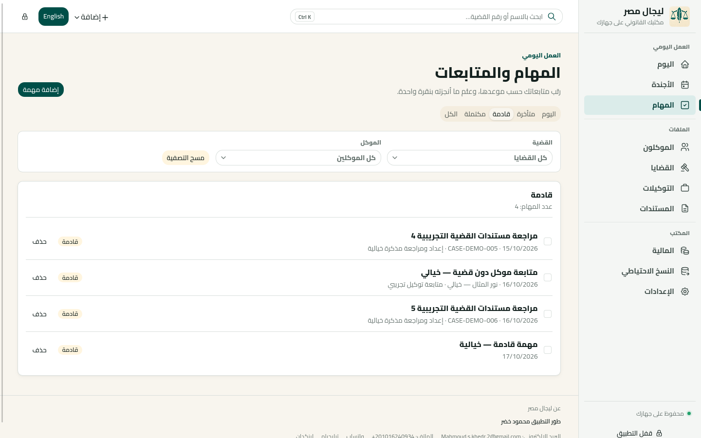

**Completed**


**All**


**delete**


Source: [TasksPage](../../src/features/tasks/pages/TasksPage.tsx), [form schemas](../../src/lib/formSchemas.ts), [task service](../../src-tauri/src/services/task_service.rs), [task repository](../../src-tauri/src/repositories/task_repository.rs).

## 9. Finance

### 9.1 Fee agreement

One visible input: agreed amount in EGP **required**, strictly positive, parsed into piasters. Case ID comes from current case. Existing amount prefills editor. Saving upserts one agreement for the case. The DTO supports agreement date and notes, but the current fee editor exposes neither. There is no fee-delete/clear agreement workflow; a zero amount cannot save. Saving the UI amount supplies no agreement date/notes; the repository upsert assigns those optional payload fields as well, so backend-created date/notes are not preserved by omission.

### 9.2 Payment create/edit

| Input         | Payload                          | Required/default                 | Rules                                                                       |
| ------------- | -------------------------------- | -------------------------------- | --------------------------------------------------------------------------- |
| Case          | `caseId`                         | **Required**; may be preselected | Active case only; changing case resets invalid payer                        |
| Paying client | `payerClientId`                  | **Required**                     | Only clients of selected case; auto-select when sole eligible payer         |
| Amount EGP    | `amountMinor` from form `amount` | **Required**, positive           | Integer piasters; reject malformed/negative/zero/overprecision/unsafe range |
| Payment date  | `paymentDate`                    | **Required**, today default      | Date-only                                                                   |
| Method        | `paymentMethod`                  | Optional                         | Cash, bank transfer, cheque, electronic, other; blank allowed               |
| Notes         | `notes`                          | Optional                         | Free text                                                                   |

Edit includes hidden payment ID and prefilled values. Payments always belong to a case and payer; an unlinked payment is invalid. Rust/database enforce payer membership even if renderer is bypassed. Existing archived-case payment cannot be edited/deleted or moved to an active case to bypass protection.

### 9.3 Expense create/edit

| Input      | Payload       | Required/default                  | Rules                                                    |
| ---------- | ------------- | --------------------------------- | -------------------------------------------------------- |
| Amount EGP | `amountMinor` | **Required**, positive            | Same parser as payment                                   |
| Date       | `expenseDate` | **Required**, today default       | Date-only                                                |
| Type       | `expenseType` | **Required**, `COURT_FEE` default | Court fee, transport, office supplies, expert fee, other |
| Case       | `caseId`      | Optional                          | Active case; selecting clears/disables direct client     |
| Client     | `clientId`    | Optional                          | Direct owner if no case                                  |
| Notes      | `notes`       | Optional                          | Free text                                                |

Case/client/none are valid exclusive choices; both links refused by service and database. Case-linked client names shown in form are explanatory context, not additional stored ownership. Edit supplies hidden expense ID. Expense attachments exist at backend level; the expense form has no upload control.

### 9.4 Visible outputs

Global Finance has Payments/Expenses tabs, case/client filters and clear-filter action. Ledger shows current record count and **sum of current tab's filtered records**, then date, method/type, linked case/payer/client context, amount and edit action. Date/action opens inspection. Rows are newest date first. There is no user-facing from/to date filter even though list payloads support it.

Selecting a case additionally shows four case totals: agreed, received, outstanding, expenses. Those totals are the entire case account, not narrowed by payer/client filter or current tab. **Case net cash is calculated in the backend DTO but displayed in neither four-card case summary. Client Account does display client net cash.**

Inspection shows date, case, client/payer, amount and notes, plus Close/Edit/Delete where allowed. Global ledger also displays notes beneath method/type. It does not separately repeat method/type, which is visible in the ledger and edit form. Delete is a nested confirmation. Expense deletion with documents is refused; remove managed documents first. Refusal/cancel preserves totals.

### 9.5 Exact calculation contract

Let `P(case)` be payments for a case, `E(case)` its directly case-linked expenses, `P(client)` payments whose payer is that client, and `C(client)` case IDs containing the client.

| Output           | Formula in integer piasters                                                       |
| ---------------- | --------------------------------------------------------------------------------- |
| Case agreed      | Single fee agreement amount, or 0                                                 |
| Case received    | `sum(P(case).amountMinor)`                                                        |
| Case outstanding | `max(agreed - received, 0)`                                                       |
| Case expenses    | `sum(E(case).amountMinor)`                                                        |
| Case net cash    | `received - expenses` (can be negative)                                           |
| Client received  | `sum(P(client).amountMinor)`                                                      |
| Client expenses  | Sum of direct-client expenses **plus** case expenses where case is in `C(client)` |
| Client net cash  | `client received - client expenses`                                               |

**Example:** case fee 3,000.00; client A payment 1,500.25; case expense 250.00. Case received 1,500.25, outstanding 1,499.75, net 1,250.25. A received 1,500.25 and expenses 250.00. If client B shares the case without paying, B received 0 but expenses 250.00 and net −250.00. The expense is not split between A/B. Adding client accounts is therefore not an office-wide financial total. Overpayment is accepted; outstanding is clamped at zero, with no credit-balance output.

**Screenshots**

**case fee/account**


**payments ledger**


**expenses ledger**


**payment create**


**payment edit**


**expense create**


**expense edit**


**payment inspection**


**expense inspection**


Source: [FinancesPage/forms](../../src/features/finances/pages/FinancesPage.tsx), [finance service](../../src-tauri/src/services/finance_service.rs), [calculation SQL](../../src-tauri/src/repositories/finance_repository.rs), [money parser](../../src/lib/money.ts).

## 10. Documents

### 10.1 Inputs

| Step/form                   | Inputs                                                                                            | Rules                                                                                |
| --------------------------- | ------------------------------------------------------------------------------------------------- | ------------------------------------------------------------------------------------ |
| Global Add document → owner | Owner kind: case/client/POA; selected existing owner                                              | Exactly one; active choices; navigates to scoped add form; expense owner not offered |
| Scoped add                  | Local file **required** via native picker; category; optional description; optional document date | Renderer gets one-use token plus filename, not source path; default category `OTHER` |
| Metadata edit               | Category, description, document date                                                              | Prefilled; same underlying file/owner; cannot replace file or change owner           |
| Remove                      | Confirmation/cancel                                                                               | Removes managed copy/metadata; source file remains untouched                         |

Categories: identification, power of attorney, case file, court decision, evidence, receipt, correspondence, other (`IDENTIFICATION`, `POWER_OF_ATTORNEY`, `CASE_FILE`, `COURT_DECISION`, `EVIDENCE`, `RECEIPT`, `CORRESPONDENCE`, `OTHER`). Category is a required enum with a default, not a blank free-text field. Document date is date-only.

### 10.2 Outputs and file flow

Global list shows filename/extension marker, category, optional document date, size, optional description, owner context/link, Open, Show in folder, Edit and Remove. Scoped panels show only the owner's files. No in-app document content preview/OCR/full-text search exists. Internal stored filename, relative path, MIME, SHA-256, creation/update timestamps are metadata returned by the backend, not all displayed as facts.

Picker → native source capability → Rust validates/copies to managed directory → hashes file → inserts attachment metadata. Failed copy/database write cleans up; token is consumed even on failure, requiring repick. Picker cancellation is silent and must not create records. Missing managed file produces an error on open/reveal. Open/reveal resolve a known attachment ID rather than arbitrary paths. Archived-case and archived-case-expense documents are read-only for edit/remove; open/reveal remain possible.

**Screenshots**

**global list**


**owner selection**


**add**


**metadata edit**


**remove**


**missing file error**


Source: [DocumentsPage](../../src/features/documents/pages/DocumentsPage.tsx), [owner chooser](../../src/features/documents/components/ChooseDocumentOwner.tsx), [AttachmentPanel](../../src/features/documents/components/AttachmentPanel.tsx), [document service](../../src-tauri/src/services/document_service.rs).

## 11. Today, search, and workspace controls

### 11.1 Today output

Date/day heading; four counters (today's hearings, today's tasks, overdue tasks, hearings in next seven days); overdue attention section; today's hearing rows with time/all-day, case/client/court context, preparation requirements and decision state; due tasks with completion and navigation; upcoming hearings, first eight; recent case/client shortcuts, first five from returned lists. New case/client/hearing/task shortcuts open forms.

Completed hearings remain in today's hearings: they happened today. Canceled hearings are excluded by dashboard service. Today's/upcoming/overdue task arrays contain incomplete tasks only. Upcoming UI excludes today's hearings, while backend upcoming starts at today. Seven-day counter is narrower than the upcoming list. No financial or legal workload summary should be inferred from these counts.

### 11.2 Search and shell inputs/outputs

| Control               | Input                                                       | Output/effect                                                                                               |
| --------------------- | ----------------------------------------------------------- | ----------------------------------------------------------------------------------------------------------- |
| Global search         | Query text                                                  | Entity type, title, subtitle and navigation for client/case/POA results                                     |
| Command palette       | Ctrl/Command+K; query; arrows/Enter; Escape                 | Same typed search; exact result identity uses entity type + ID, so duplicate names do not open wrong record |
| Sidebar/navigation    | Section selection; narrow menu open/close                   | Today, Agenda, Tasks, Clients, Cases, POAs, Documents, Finance, Backups, Settings                           |
| Quick-add menu        | Record type                                                 | Client/case/hearing/task form; selecting menu does not itself persist a record                              |
| Language switch       | Arabic/English                                              | RTL/LTR labels/layout; digits, dates, money, phone, identifiers remain isolated by direction controls       |
| Footer/About contacts | Fixed email/phone/WhatsApp/Telegram/LinkedIn contact action | Narrow native command for fixed developer destinations; no legal data/message automatically submitted       |
| Unknown route         | Route path                                                  | Not-found page/navigation fallback; not a data-entry form                                                   |

Global search normalizes Arabic letters/digits/phone text, escapes literal wildcards, and searches indexed identity fields. It does not search inside attachment contents or every note. A result may be correct in SQL but stale in a cached view: test both.

**Screenshots**

**workspace**


**Today**


**quick add**


**search**


**palette**


Source: [DashboardPage](../../src/features/dashboard/pages/DashboardPage.tsx), [dashboard service](../../src-tauri/src/services/dashboard_service.rs), [GlobalSearch](../../src/features/search/components/GlobalSearch.tsx), [search service](../../src-tauri/src/services/search_service.rs), [router](../../src/app/router.tsx).

## 12. Settings

| Tab/form                        | Inputs                                                                                                | Output/effect                                                                                          |
| ------------------------------- | ----------------------------------------------------------------------------------------------------- | ------------------------------------------------------------------------------------------------------ |
| Profile                         | Lawyer full name **required**; optional bar number, phone, office address                             | Existing values prefilled; save feedback; profile update; currency fixed EGP, not selectable           |
| Display/general                 | Language `ar/en`; theme `system/light/dark`; date format `dd/MM/yyyy` or `yyyy-MM-dd`; week start 0–6 | Saved preferences affect localization/theme/date formatting/calendar; legal dates do not change        |
| Security → auto-lock            | Timeout integer 1–1440 minutes; presets retain custom saved value                                     | Saves lock timeout; no OS autostart setting                                                            |
| Security → change password      | Current password **required**; new password **required** ≥12; matching confirmation                   | On success clears password fields; Rust authenticates old password and rewraps master key              |
| Security → recovery replacement | Current password **required**; replace action                                                         | Displays newly generated key once with save/copy/print controls and Done; old recovery key invalidated |
| Backups                         | Same controls/forms as standalone Backups                                                             | Same preparation/preview/replacement behavior; no separate backup implementation                       |
| Privacy                         | No data-entry inputs                                                                                  | Text explaining managed documents, local backups/network behavior; backup-management link              |
| About                           | Contact buttons, no profile inputs                                                                    | Brand/version `0.1.0`, developer credits, fixed contact options                                        |

`usageCountersEnabled` exists in settings/bridge but has no current checkbox/tab. Notifications, reminder lead time, autostart, backup schedule, retention, primary destination and history are not current controls. Do not derive UI requirements from removed migration columns.

**Screenshots**

**profile**


**display**


**security**


**password mismatch**


**backup settings**


**privacy**


**About**


Source: [SettingsPage](../../src/features/settings/pages/SettingsPage.tsx), [settings schema](../../src/features/settings/schemas/settings.schema.ts), [RecoveryKeySection](../../src/features/settings/components/RecoveryKeySection.tsx), [settings service](../../src-tauri/src/services/settings_service.rs).

## 13. Backups and restore

### 13.1 Inputs and outputs

| Action/state               | Inputs                                                                                       | Visible output / effect                                                                                                     |
| -------------------------- | -------------------------------------------------------------------------------------------- | --------------------------------------------------------------------------------------------------------------------------- |
| Backups page               | No record fields                                                                             | Latest successful completion date/time, size when available; no-backup/stale advice (≥7 days); create/check/restore actions |
| Create now                 | Click only; generated timestamp provided internally                                          | Manual authenticated archive in app-data backup folder; busy/success/error feedback and archive name                        |
| Save copy elsewhere        | Native destination dialog                                                                    | Copies latest backup; saved-copy filename feedback; canceled dialog silent                                                  |
| Show backup in folder      | Click only                                                                                   | Native file-manager reveal; no arbitrary path input                                                                         |
| Choose backup              | Native backup picker                                                                         | Renderer gets filename and capability token; no raw file path entry                                                         |
| Authenticate with password | Backup password **required**                                                                 | Preparation; wrong password error; active-vault key can prepare same-vault archive without typing password                  |
| Authenticate with recovery | Recovery key **required**; new password ≥12 **required**; matching confirmation **required** | Prepares backup and stages replacement password; password-source notice in preview                                          |
| Validate preview           | Prepared token, no business edits                                                            | Archive creation date/time and managed document count; no replacement confirmation button                                   |
| Restore preview            | Prepared token + explicit confirmation                                                       | Same date/document count; replacement warning and post-restore password notice; confirm/cancel                              |
| Commit restore             | Confirmation click                                                                           | Journaled replacement of vault/files; clears queries and locks; requires correct restored password to unlock                |
| Cancel/close               | Click                                                                                        | Cancels preparation; no live-record replacement                                                                             |

Preview does **not** show counts/lists of clients, cases, payments, tasks or field-by-field changes. It proves an archive prepared, not that the user has compared business contents. File selection/authentication alone must not replace the active workspace.

First-run/incomplete installations and Settings share `RestoreFromBackup`. Same-vault preparation may use active key. Foreign archive needs password/recovery authentication. Recovery restore stages the new password in the replacement journal. Corrupt/truncated/unsupported archives must leave the live vault unchanged. A file's `.lmsbackup` name alone is not validation.

### 13.2 Scope and expected assertions

Backups include encrypted vault data, access material and managed attachments under the canonical authenticated format. There is no automatic schedule/retention/history/configurable main destination. Backup is not a client export, stable CSV, case-folder export, or permanent deletion tool.

Tests must compare **distinct** snapshots, not identical reseeds: restore A after later mutations must remove those later mutations, restore the exact profile/preferences/relationships/amounts, preserve document bytes/hashes, and lock. Wrong credentials/corrupt archive/canceled preview must preserve full current state. Restart and interrupted journal recovery need backend/native coverage beyond screenshots.

**Screenshots**

**Backups**


**created**


**choose/replace warning**


**password form**


**recovery form**


**validation preview**


**restore preview**


**corrupt refusal**


Source: [backup contract](../plan/07-backup-format.md), [BackupsPage](../../src/features/backups/pages/BackupsPage.tsx), [RestoreFromBackup](../../src/features/backups/components/RestoreFromBackup.tsx), [backup service](../../src-tauri/src/services/backup_service.rs).

## 14. Cross-screen update expectations

These are acceptance expectations, not a claim that every current hook satisfies them. Verify without restarting/navigating away to force a cache reset.

| Mutation                         | Outputs expected to change                                                                                    | Outputs expected to remain unchanged                                        |
| -------------------------------- | ------------------------------------------------------------------------------------------------------------- | --------------------------------------------------------------------------- |
| Client create                    | Client list/detail, client picker, global search                                                              | Existing clients, cases, money                                              |
| Client name/phone/number edit    | Client detail/list, related case/POA client labels, owner/payer selectors, dependent search hits              | Case/client IDs, memberships, payments/expenses                             |
| Case core edit                   | Case list/detail, hearing/task case context, POA case labels and search                                       | Existing client capacity/notes, opponents, transactions                     |
| Case membership edit             | Case Parties, former/new client case lists, POA derived cases, client-derived tasks/expenses/accounts, search | Core case fields and unrelated records; payer removal refusal preserves all |
| POA create/edit/archive/restore  | POA list/detail, linked client POA history, case client POA output, active-client availability, search        | Case memberships and money                                                  |
| Hearing save/delete              | Case earliest pending date, timeline, Today, Agenda                                                           | Case financial totals                                                       |
| Hearing decision + follow-up     | Source completed/decision, new scheduled successor, Today state, Agenda and earliest pending date             | Existing documents; source/successor notes are not silently copied          |
| Task save/complete/reopen/delete | Task buckets/counts, Today, Agenda, case task list                                                            | Financial accounts                                                          |
| Fee/payment/expense save/delete  | Relevant ledgers and all affected case/client totals, including former owners after reassignment              | Nonfinancial identity fields                                                |
| Attachment add/edit/remove       | Owner/global document lists; managed metadata/bytes                                                           | Original source file and unrelated owners' document lists                   |
| Preferences/profile save         | Persisted settings/profile; affected presentation                                                             | Business date-only values and integer amounts                               |
| Lock/restore                     | Vault session and all sensitive cache state                                                                   | Cancel/refusal must not alter live records                                  |

Source: [query invalidation rules](../../src/lib/queryInvalidation.ts), [client hooks](../../src/features/clients/api/clientsApi.ts), [case hooks](../../src/features/cases/api/casesApi.ts), [POA hooks](../../src/features/powersOfAttorney/api/powersOfAttorneyApi.ts), [finance hooks](../../src/features/finances/api/financesApi.ts), [cache clearing](../../src/lib/vaultCache.ts).

## 15. Test-contract matrix

Every form test should assert the submitted payload and exact saved values after reopening. Every view test should assert visible values against an independently calculated expected dataset. The same function used by production to compute a result should not be the sole test oracle.

| Contract ID | Normal acceptance                                                                                       | Failure acceptance                                                                                                       | Existing evidence anchor                                                                                                                                                                            |
| ----------- | ------------------------------------------------------------------------------------------------------- | ------------------------------------------------------------------------------------------------------------------------ | --------------------------------------------------------------------------------------------------------------------------------------------------------------------------------------------------- |
| ACCESS-01   | Setup, saved-key acknowledgment, lock/unlock, restart                                                   | Required/short/mismatch; wrong password/key; locked commands refused                                                     | [onboarding tests](../../src/features/onboarding/pages/OnboardingPage.test.tsx), [native desktop](../../scripts/desktop-e2e.mjs)                                                                    |
| CLIENT-01   | Every optional field create/edit/reopen; list/search/detail correct                                     | Blank trimmed required fields; duplicate number; probable duplicate confirmation; save retains draft                     | [domain forms](../../src/features/domainForms.test.tsx), [workflows](../../src/features/workflows.test.tsx), [native controls](../../scripts/full-app-native-controls.mjs)                          |
| CLIENT-02   | Case/POA/account/document tabs show correct scoped data                                                 | Read failure must not masquerade as a real empty/zero result                                                             | [client detail](../../src/features/clients/pages/ClientDetailPage.test.tsx), [office integrity](../../scripts/realistic-office-fixture.mjs); see §16                                                |
| POA-01      | Multiple clients/lawyers; issue-year derivation; duplicate official numbers; shared case once           | Empty clients/lawyer name; duplicate sequence; second active POA; conflicting restore                                    | [POA form tests](../../src/features/powersOfAttorney/components/PowerOfAttorneyForm.test.tsx), [link tests](../../src-tauri/tests/case_client_poa_links.rs)                                         |
| CASE-01     | All core fields/year types persist; linked client preselect; edit preserves relations                   | Empty clients/internal number; year/date validation; duplicate number; failed choices load                               | [case schema tests](../../src/features/cases/schemas/case.schema.test.ts), [core edit](../../src/features/cases/forms/CaseEditForm.test.tsx), native office                                         |
| CASE-02     | Capacity/notes save; former/new links refresh; derived POA correct                                      | Last-client removal; duplicate clients; payer removal; new archived client; failed save leaves draft/DB/search unchanged | [CaseClientsPanel tests](../../src/features/cases/components/CaseClientsPanel.test.tsx), [native controls](../../scripts/full-app-native-controls.mjs)                                              |
| CASE-03     | Opponent fields create/edit; confirm remove                                                             | Missing name; cancel remove; archived case; rejected save retains values                                                 | [opponent tests](../../src/features/cases/components/CasePartiesPanel.test.tsx), native controls                                                                                                    |
| HEARING-01  | All text fields/time/date create/edit; decision and linked successor                                    | Invalid date/time; nonscheduled edit; archived case; failed transaction/cancel delete                                    | [Agenda tests](../../src/features/hearings/pages/AgendaPage.test.tsx), [native office](../../scripts/full-app-native-audit.mjs), [domain matrix](../../src-tauri/tests/canonical_domain_matrix.rs)  |
| TASK-01     | Exact buckets; case/client/none; derived client list; complete/reopen                                   | Both links; blank title/date; archived original/proposed owner; cancel/refused deletion                                  | [task tests](../../src/features/tasks/pages/TasksPage.test.tsx), [TaskLinks](../../src/features/tasks/pages/TaskLinks.test.tsx), [Rust links](../../src-tauri/tests/case_client_poa_links.rs)       |
| MONEY-01    | Decimal/Arabic amounts exact; payer-filtered payments; exclusive/unlinked expenses                      | Nonmember payer; zero/negative/invalid/overprecision; both expense links; missing case/date                              | [finance UI tests](../../src/features/finances/pages/FinancesPage.ui.test.tsx), [money tests](../../src/lib/money.test.ts), [finance repository tests](../../src-tauri/tests/finance_repository.rs) |
| MONEY-02    | Independent per-case/per-client totals; reassignment/delete recalculates all affected owners            | Cancel/refusal leaves entire office unchanged; expense with attachments refused                                          | [office reconciliation](../../scripts/realistic-office-fixture.mjs), native office/controls; shared-case expectation in §9                                                                          |
| DOC-01      | Correct owner, copied bytes/hash, metadata edit, original source preserved                              | Cancel picker; consumed token; failed copy cleanup; multiple/no owners; missing file; archived-case mutation             | [AttachmentPanel tests](../../src/features/documents/components/AttachmentPanel.test.tsx), native office, Rust document service tests                                                               |
| SEARCH-01   | Arabic normalization, phone, wildcard literal, duplicate-title identity, immediate dependent updates    | No result/error; Escape; stale cached response must not route wrong entity                                               | [search tests](../../src/features/search/components/GlobalSearch.test.tsx), [search repository](../../src-tauri/src/repositories/search_repository.rs); cache risks in §16                          |
| SETTINGS-01 | Profile optional fields, language/theme/date/week/timeout persist                                       | Invalid enums/ranges/name; wrong old password; mismatch; recovery-key authentication                                     | [settings workflow tests](../../src/features/settings/pages/SettingsPage.workflows.test.tsx), native controls                                                                                       |
| BACKUP-01   | Real archive; validation preview; distinct snapshots restore all data and bytes; password-source notice | Wrong credentials, corrupt/newer format, cancel, interruption; no data replaced before confirmation                      | [restore tests](../../src/features/backups/components/RestoreFromBackup.test.tsx), [backup Rust module](../../src-tauri/src/backup/mod.rs), [native desktop](../../scripts/desktop-e2e.mjs)         |
| PRESENT-01  | Arabic RTL/English LTR; mixed-direction IDs/money/date; responsive scrolling and usable modal footer    | Long labels, multiline fields, failed clipboard, blocked picker; no hidden required action                               | [locale tests](../../src/i18n/catalogParity.test.ts), [native controls](../../scripts/full-app-native-controls.mjs), fresh screenshots                                                              |

The last commit materially improves native field round trips and office reconciliation. It does not automatically certify every row above. Read [the dated E2E review](2026-10-14-end-to-end-testing.md) for its reported run counts and physical-platform exclusions. This report adds the explicit output oracle needed when expanding those tests.

## 16. Findings and unresolved decisions

### 16.1 Confirmed inventory/documentation differences

1. **Case fields omitted from the older inventory:** `officialYear` is an input, separate from `judicialYear`; both must be tested and described.
2. **POA clients are required:** at least one distinct client is enforced by form and Rust. Each added lawyer row also requires full name. The previous brief list did not make either condition clear.
3. **Client account output is narrower than case account:** received/expenses/net only. There is no client agreed fee/outstanding output or client Tasks tab.
4. **Relationship notes have limited visibility:** stored/editable on case-client relationship, absent from normal Parties rows. Opponent address/notes and task notes likewise need editor round-trip assertions rather than assumed detail-page output.
5. **Unlock requirement differs from old inventory:** unlock accepts a nonempty password; the 12-character policy applies to new passwords.
6. **Internal metadata is not a user-facing fact:** IDs, hashes, timestamps, stored paths, predecessor IDs and fee agreement date/notes may exist in DTOs without a visible input/output. Test actual UI and backend contracts separately.

Case `netCashMinor` is also a backend output with no case-page display: both case summaries render four cards. Only the client account renders net cash. A test asserting a fifth case card would test an unimplemented UI.

### 16.2 Business behavior requiring explicit product sign-off

7. **Full shared-case expenses attributed to each client:** implemented and covered by Rust/client-derived expense tests. This is not proportional cost allocation. Decide whether this is the intended client financial meaning; do not total client accounts as office expenses.
8. **Outstanding clamps overpayment to zero:** no refund/credit representation; positive payment can exceed fee. Decide whether an overpayment indicator is needed.
9. **Same/earlier next-hearing date is advisory only:** current form warns but permits it; service validates real date, not chronological ordering.
10. **Blank hearing decision can complete a hearing:** both decision text and next date optional. Decide whether completion should require a decision text.
11. **Client format validation is intentionally weak/currently absent:** national ID, phone and email are text, without official format/length checks. Any stricter expectation requires a new business rule and tests.
12. **Archived client/POA is not globally read-only:** client/POA Edit remains offered; archived cases enforce read-only. Define expectations independently for each entity.
13. **Client-linked archived cases are hidden in client Cases tab:** that query does not opt into archived cases, while POA history includes archived POAs. Decide whether historical case visibility is expected there.

### 16.3 Source-observed risks needing focused verification

14. **Case chronology/reference constraints differ by boundary:** renderer rejects closing before filing and year without official number. Rust `validate_case` checks valid dates/year ranges but does not implement those two cross-field checks; database likewise has no corresponding ordering/number-with-year constraint. Tests bypassing renderer must not assume equivalent validation. Add service rules if these are intended invariants.
15. **Client-edit cache refresh may be incomplete:** backend rebuilds dependent search text, but `useUpdateClient` only invalidates client queries. Related case/POA cached DTO labels and already cached global-search results are not explicitly invalidated by that hook. A restart/remount can mask stale-cache behavior. Verify immediate outputs using preloaded dependent views and identical queries.
16. **POA membership edits refresh returned dependents only:** current POA mutation invalidation iterates resulting client/case IDs, without fetching prior memberships. Removed owners' cached case/client relationships may require explicit refresh. Case membership editor already invalidates both previous and resulting relationships, making it a useful comparison.
17. **Some secondary detail reads can look like empty/zero:** ClientDetail falls back to empty cases/zero account when related query data is unavailable; it explicitly handles POA errors but not all case/account errors. CaseDetail similarly substitutes zero/empty for several secondary query results. A screenshot of zero is not proof of a successful financial read. Add explicit failed-subquery view assertions and visible error/loading treatment if required.

18. **Archived-client context can disappear in global rows:** global Finance/Tasks look up names using active-only client lists. Existing payments or direct-client tasks can survive client archive while their client label becomes unavailable in those views. Case detail hydrates client relationships separately. Verify historical name visibility rather than assuming archival deletes records.

Items 14–18 are grounded in source inspection. They are not claimed as newly reproduced native failures in this report. No fixes are included in this documentation task.

## 17. Validation and limitations

| Check run for this report                                              | Result                                                                                                                                   |
| ---------------------------------------------------------------------- | ---------------------------------------------------------------------------------------------------------------------------------------- |
| `pnpm build:desktop:e2e` (includes TypeScript/Vite production build)   | Passed; native binary rebuilt from the cited application revision                                                                        |
| `pnpm test`                                                            | **579 renderer tests passed (57 files); 80 Node tests passed**                                                                           |
| Focused renderer contract rerun                                        | **119 passed**, six files; normal and failure workflows                                                                                  |
| Rust domain/link/finance integration rerun                             | **26 passed** across `canonical_domain_matrix`, `case_client_poa_links`, `finance_repository`                                            |
| `pnpm lint`, `pnpm typecheck`, `pnpm format:check`, `git diff --check` | Passed after temporary capture runner cleanup                                                                                            |
| Native capture and office integrity                                    | Exactly 10 clients / 7 cases at the fixture checkpoint; independent relation/finance/hearing reconciliation passed in each capture run   |
| Current screenshot evidence                                            | **122 inspected screenshots covering 95 states**, Arabic native Linux; all accepted PNGs have hashes/dimensions in the accepted manifest |
| Primary capture blockers                                               | Five stale capture-selector/portal-scope failures; all five recaptured successfully in the supplemental run                              |
| Report integrity                                                       | No broken local links or screenshot hash mismatches; Markdown renders 122 images in 95 state galleries                                   |
| Additional confirmations/security output                               | Four states captured successfully, including the redacted replacement recovery key                                                       |

The earlier capture attempts used outdated guide selectors and one wrong-password driver request timed out. Those attempts are not reported as successful application validation. No wrong-password screenshot was accepted; its contract is supported by source, renderer/Rust tests, and the separately dated E2E review. The final selected evidence is indexed in [accepted-manifest.json](evidence/2026-10-14-data-contract/accepted-manifest.json), with primary/supplemental/extra origins preserved. The full native E2E suite and physical Windows/macOS journeys were not rerun for this documentation task.

Reproduce new documentation captures (requires an X11 display, `tauri-driver`, `WebKitWebDriver`; the prior native test-tool directory was used in this session):

```bash
pnpm build:desktop:e2e
TZ=Africa/Cairo GUIDE_LANGUAGES=ar NATIVE_AUDIT_OUTPUT=test-results/data-contract node scripts/data-contract-capture.mjs
# Include additional case/finance confirmations and the replacement-key output:
TZ=Africa/Cairo GUIDE_LANGUAGES=ar DOC_SCREEN_FILTER='^$' DOC_EXTRA_CONTROLS=true NATIVE_AUDIT_OUTPUT=test-results/data-contract-extra node scripts/data-contract-capture.mjs
```

The [capture adapter](../../scripts/data-contract-capture.mjs) reuses the isolated native harness and current audit fixture. It updates obsolete guide selectors for this report, resets residual search input between states, and captures palette results from their actual portal. Palette capture uses the small-window search button and returns to 1440×900; it is **not** a claim that the native keyboard shortcut was verified here. Source, existing keyboard tests, and rendered palette state are separate evidence.

The application build may warn about the large JavaScript chunk; that is not evidence of incorrect data contracts. Screenshots cover native Linux at 1440×900, light theme, Cairo timezone. They do not establish physical Windows/macOS native file dialogs, OS document open/reveal, clipboard/printing integration, screen-reader compliance, or every combination of empty/error/archive states. Startup error/incomplete/interrupted branches and the not-found route are source-documented; they have no accepted screenshot in this run. The table in §15 specifies failure contracts even when a corresponding screenshot is not present.

A screenshot is sufficient to confirm that an input/output is rendered in the pictured state. It cannot establish database constraints, atomicity, cryptographic validation, or what every user should consider financially correct. Those claims require source/tests and explicit product decisions.

## 18. Screenshot evidence gallery

All 95 captured states appear below as visible images. Long screens include their additional viewport captures.

### 01. First-run setup

**Part 1:** First-run setup — native Arabic RTL, 1440×900.


### 02. Correcting setup details

**Part 1:** Correcting setup details — native Arabic RTL, 1440×900.


### 03. Saving the recovery key

**Part 1:** Saving the recovery key — native Arabic RTL, 1440×900.


### 04. Unlocking the vault

**Part 1:** Unlocking the vault — native Arabic RTL, 1440×900.


### 05. Recovering access

**Part 1:** Recovering access — native Arabic RTL, 1440×900.


### 06. Navigation, search, and locking

**Part 1:** Navigation, search, and locking — native Arabic RTL, 1440×900.


**Part 2:** Navigation, search, and locking — native Arabic RTL, 1440×900.


**Part 3:** Navigation, search, and locking — native Arabic RTL, 1440×900.


### 07. Quick-add menu

**Part 1:** Quick-add menu — native Arabic RTL, 1440×900.


**Part 2:** Quick-add menu — native Arabic RTL, 1440×900.


**Part 3:** Quick-add menu — native Arabic RTL, 1440×900.


### 08. Today dashboard

**Part 1:** Today dashboard — native Arabic RTL, 1440×900.


**Part 2:** Today dashboard — native Arabic RTL, 1440×900.


**Part 3:** Today dashboard — native Arabic RTL, 1440×900.


### 09. Global search results

**Part 1:** Global search results — native Arabic RTL, 1440×900.


**Part 2:** Global search results — native Arabic RTL, 1440×900.


**Part 3:** Global search results — native Arabic RTL, 1440×900.


### 10. Client list

**Part 1:** Client list — native Arabic RTL, 1440×900.


### 11. Adding a client

**Part 1:** Adding a client — native Arabic RTL, 1440×900.


**Part 2:** Adding a client — native Arabic RTL, 1440×900.


### 12. Required client fields

**Part 1:** Required client fields — native Arabic RTL, 1440×900.


**Part 2:** Required client fields — native Arabic RTL, 1440×900.


### 13. Possible duplicate warning

**Part 1:** Possible duplicate warning — native Arabic RTL, 1440×900.


**Part 2:** Possible duplicate warning — native Arabic RTL, 1440×900.


### 14. Client summary

**Part 1:** Client summary — native Arabic RTL, 1440×900.


### 15. Client cases

**Part 1:** Client cases — native Arabic RTL, 1440×900.


### 16. Client powers of attorney

**Part 1:** Client powers of attorney — native Arabic RTL, 1440×900.


### 17. Client account

**Part 1:** Client account — native Arabic RTL, 1440×900.


### 18. Client documents

**Part 1:** Client documents — native Arabic RTL, 1440×900.


### 19. Editing a client

**Part 1:** Editing a client — native Arabic RTL, 1440×900.


### 20. Archiving a client

**Part 1:** Archiving a client — native Arabic RTL, 1440×900.


### 21. Archived client with Restore action

**Part 1:** Archived client with Restore action — native Arabic RTL, 1440×900.


### 22. Power-of-attorney list

**Part 1:** Power-of-attorney list — native Arabic RTL, 1440×900.


### 23. Adding a power of attorney

**Part 1:** Adding a power of attorney — native Arabic RTL, 1440×900.


**Part 2:** Adding a power of attorney — native Arabic RTL, 1440×900.


### 24. Power-of-attorney summary

**Part 1:** Power-of-attorney summary — native Arabic RTL, 1440×900.


### 25. Power-of-attorney clients

**Part 1:** Power-of-attorney clients — native Arabic RTL, 1440×900.


### 26. Named lawyers

**Part 1:** Named lawyers — native Arabic RTL, 1440×900.


### 27. Cases using this power of attorney

**Part 1:** Cases using this power of attorney — native Arabic RTL, 1440×900.


### 28. Power-of-attorney documents

**Part 1:** Power-of-attorney documents — native Arabic RTL, 1440×900.


### 29. Editing a power of attorney

**Part 1:** Editing a power of attorney — native Arabic RTL, 1440×900.


**Part 2:** Editing a power of attorney — native Arabic RTL, 1440×900.


### 30. Archiving a power of attorney

**Part 1:** Archiving a power of attorney — native Arabic RTL, 1440×900.


### 31. Archived POA with Restore action

**Part 1:** Archived POA with Restore action — native Arabic RTL, 1440×900.


### 32. Case list

**Part 1:** Case list — native Arabic RTL, 1440×900.


### 33. Adding a case

**Part 1:** Adding a case — native Arabic RTL, 1440×900.


**Part 2:** Adding a case — native Arabic RTL, 1440×900.


### 34. Case summary

**Part 1:** Case summary — native Arabic RTL, 1440×900.


### 35. Clients and opponents

**Part 1:** Clients and opponents — native Arabic RTL, 1440×900.


### 36. Case hearings

**Part 1:** Case hearings — native Arabic RTL, 1440×900.


### 37. Case tasks

**Part 1:** Case tasks — native Arabic RTL, 1440×900.


### 38. Case documents

**Part 1:** Case documents — native Arabic RTL, 1440×900.


### 39. Case account and fees

**Part 1:** Case account and fees — native Arabic RTL, 1440×900.


**Part 2:** Case account and fees — native Arabic RTL, 1440×900.


### 40. Editing a case and client relationships

**Part 1:** Editing a case and client relationships — native Arabic RTL, 1440×900.


**Part 2:** Editing a case and client relationships — native Arabic RTL, 1440×900.


### 41. Adding an opponent

**Part 1:** Adding an opponent — native Arabic RTL, 1440×900.


### 42. Editing an opponent

**Part 1:** Editing an opponent — native Arabic RTL, 1440×900.


### 43. Removing an opponent

**Part 1:** Removing an opponent — native Arabic RTL, 1440×900.


### 44. Archived case

**Part 1:** Archived case — native Arabic RTL, 1440×900.


### 45. Month view

**Part 1:** Month view — native Arabic RTL, 1440×900.


**Part 2:** Month view — native Arabic RTL, 1440×900.


### 46. Week view

**Part 1:** Week view — native Arabic RTL, 1440×900.


**Part 2:** Week view — native Arabic RTL, 1440×900.


### 47. List view

**Part 1:** List view — native Arabic RTL, 1440×900.


**Part 2:** List view — native Arabic RTL, 1440×900.


### 48. Adding a hearing

**Part 1:** Adding a hearing — native Arabic RTL, 1440×900.


### 49. Editing a hearing

**Part 1:** Editing a hearing — native Arabic RTL, 1440×900.


### 50. Recording a decision and next hearing

**Part 1:** Recording a decision and next hearing — native Arabic RTL, 1440×900.


### 51. Deleting a hearing

**Part 1:** Deleting a hearing — native Arabic RTL, 1440×900.


### 52. Today’s tasks

**Part 1:** Today’s tasks — native Arabic RTL, 1440×900.


### 53. Overdue tasks

**Part 1:** Overdue tasks — native Arabic RTL, 1440×900.


### 54. Upcoming tasks

**Part 1:** Upcoming tasks — native Arabic RTL, 1440×900.


### 55. Completed tasks

**Part 1:** Completed tasks — native Arabic RTL, 1440×900.


### 56. All tasks

**Part 1:** All tasks — native Arabic RTL, 1440×900.


**Part 2:** All tasks — native Arabic RTL, 1440×900.


### 57. Adding a task

**Part 1:** Adding a task — native Arabic RTL, 1440×900.


### 58. Editing and completing a task

**Part 1:** Editing and completing a task — native Arabic RTL, 1440×900.


### 59. Deleting a task

**Part 1:** Deleting a task — native Arabic RTL, 1440×900.


### 60. All documents

**Part 1:** All documents — native Arabic RTL, 1440×900.


**Part 2:** All documents — native Arabic RTL, 1440×900.


### 61. Adding a document copy

**Part 1:** Adding a document copy — native Arabic RTL, 1440×900.


### 62. Editing document metadata

**Part 1:** Editing document metadata — native Arabic RTL, 1440×900.


### 63. Removing a document

**Part 1:** Removing a document — native Arabic RTL, 1440×900.


### 64. Document could not be opened

**Part 1:** Document could not be opened — native Arabic RTL, 1440×900.


### 65. Payment register

**Part 1:** Payment register — native Arabic RTL, 1440×900.


### 66. Expense register

**Part 1:** Expense register — native Arabic RTL, 1440×900.


### 67. Adding a payment

**Part 1:** Adding a payment — native Arabic RTL, 1440×900.


### 68. Adding an expense

**Part 1:** Adding an expense — native Arabic RTL, 1440×900.


### 69. Backup page

**Part 1:** Backup page — native Arabic RTL, 1440×900.


### 70. Backup created successfully

**Part 1:** Backup created successfully — native Arabic RTL, 1440×900.


### 71. Restore file selection and replacement warning

**Part 1:** Restore file selection and replacement warning — native Arabic RTL, 1440×900.


### 72. Lawyer profile

**Part 1:** Lawyer profile — native Arabic RTL, 1440×900.


### 73. Display and calendar

**Part 1:** Display and calendar — native Arabic RTL, 1440×900.


### 74. Security

**Part 1:** Security — native Arabic RTL, 1440×900.


**Part 2:** Security — native Arabic RTL, 1440×900.


### 75. Backups in Settings

**Part 1:** Backups in Settings — native Arabic RTL, 1440×900.


**Part 2:** Backups in Settings — native Arabic RTL, 1440×900.


### 76. Privacy and data location

**Part 1:** Privacy and data location — native Arabic RTL, 1440×900.


### 77. About the app

**Part 1:** About the app — native Arabic RTL, 1440×900.


### 78. Correcting password confirmation

**Part 1:** Correcting password confirmation — native Arabic RTL, 1440×900.


**Part 2:** Correcting password confirmation — native Arabic RTL, 1440×900.


### 79. Edit clients, legal capacities and relationship notes

**Part 1:** Edit clients, legal capacities and relationship notes — native Arabic RTL, 1440×900.


### 80. Adding a client inside a power of attorney

**Part 1:** Adding a client inside a power of attorney — native Arabic RTL, 1440×900.


### 81. Choose document owner

**Part 1:** Choose document owner — native Arabic RTL, 1440×900.


### 82. Validating a backup

**Part 1:** Validating a backup — native Arabic RTL, 1440×900.


### 83. Prepared restore preview

**Part 1:** Prepared restore preview — native Arabic RTL, 1440×900.


### 84. Corrupt backup refused

**Part 1:** Corrupt backup refused — native Arabic RTL, 1440×900.


### 85. Authenticate selected backup with password

**Part 1:** Authenticate selected backup with password — native Arabic RTL, 1440×900.


### 86. Authenticate backup with recovery key and replacement password

**Part 1:** Authenticate backup with recovery key and replacement password — native Arabic RTL, 1440×900.


### 87. Keyboard search

**Part 1:** Keyboard search — native Arabic RTL, 1440×900.


**Part 2:** Keyboard search — native Arabic RTL, 1440×900.


**Part 3:** Keyboard search — native Arabic RTL, 1440×900.


### 88. Editing a payment

**Part 1:** Editing a payment — native Arabic RTL, 1440×900.


### 89. Editing an expense and its documents

**Part 1:** Editing an expense and its documents — native Arabic RTL, 1440×900.


### 90. Payment details

**Part 1:** Payment details — native Arabic RTL, 1440×900.


### 91. Expense details and receipts

**Part 1:** Expense details and receipts — native Arabic RTL, 1440×900.


### 92. Case archive confirmation

**Part 1:** Case archive confirmation — native Arabic RTL, 1440×900.


### 93. Payment delete confirmation

**Part 1:** Payment delete confirmation — native Arabic RTL, 1440×900.


### 94. Expense delete confirmation

**Part 1:** Expense delete confirmation — native Arabic RTL, 1440×900.


### 95. Replacement recovery key (redacted)

**Part 1:** Replacement recovery key (redacted) — native Arabic RTL, 1440×900.


**Part 2:** Replacement recovery key (redacted) — native Arabic RTL, 1440×900.


