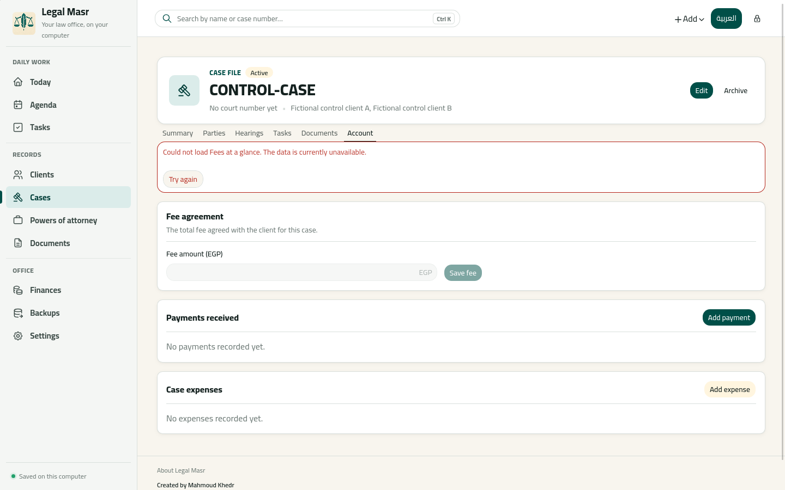
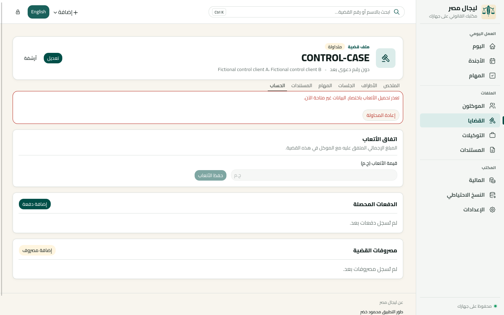
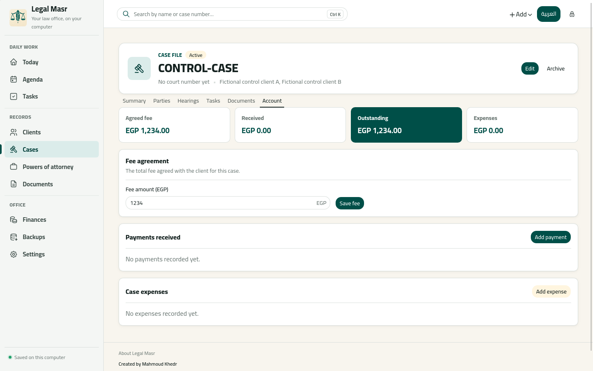
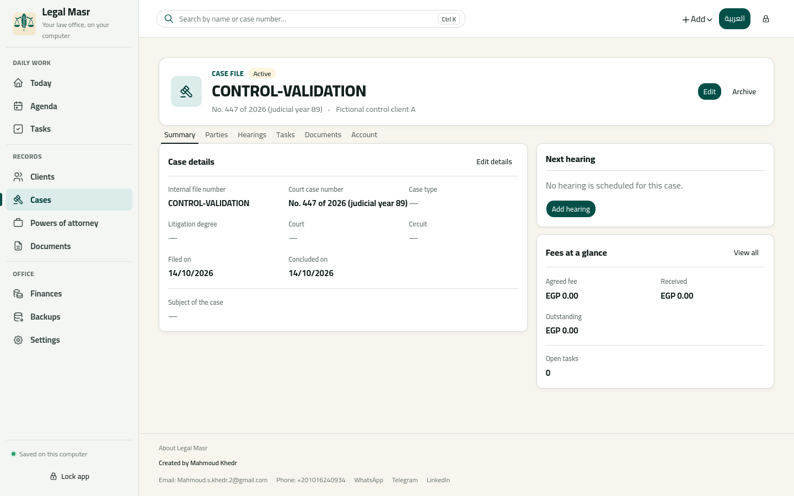

# Data-flow findings: implementation and regression report

**Date:** 2026-10-15. **Scope:** the five approved fixes, corresponding to findings 14–18 in the [system input/output report](2026-10-14-system-input-output-data-flow.md). Changes are in the working tree. No schema changes or migrations were needed.

## Changes and expected behavior

| Finding                                                       | Implementation                                                                                                                                                                                                                                                                      | What the user should now see                                                                                                                                                          |
| ------------------------------------------------------------- | ----------------------------------------------------------------------------------------------------------------------------------------------------------------------------------------------------------------------------------------------------------------------------------- | ------------------------------------------------------------------------------------------------------------------------------------------------------------------------------------- |
| 14: React/Rust validation mismatch                            | Shared Rust case validation now rejects a closing date earlier than the filing date, and either official or judicial year without a nonblank official number. Both create and update use it.                                                                                        | The same invalid case is refused whether submitted through the form or directly through the command bridge. Existing records and search data remain unchanged on refusal.             |
| 15: client edits leave related labels stale                   | Successful client create/update/archive/restore invalidates client, case, POA and search queries. The update response populates the client detail cache before refresh.                                                                                                             | Already-open case/POA labels, client lookups in finance/tasks, and cached search results refresh after a client change.                                                               |
| 16: removed POA owners remain visible in cached relationships | Successful POA save/archive/restore refreshes all client/case/POA/search query families. Relationship invalidation targets the detail queries that actually contain the relationships.                                                                                              | Former owners and cases refresh as well as resulting owners. Views read the current database-derived relationship data. Backend membership behavior is unchanged.                     |
| 17: failed reads appear as successful zero/empty results      | A reusable query section renders loading, a localized section-specific error and Retry, or successfully loaded content. Applied to client case/POA/account sections; case hearing/task/account/payment/expense sections; POA case lookup; and the selected case account on Finance. | A missing or failed read does not show financial zero or “no records.” Other successfully loaded sections stay usable. Retry refreshes the affected query.                            |
| 18: archived-client names disappear                           | Finance and Tasks load historical client lookups with `includeArchived: true`. Their new direct-client selections filter to active clients. An existing archived selection remains represented, with its option disabled.                                                           | Historical payments and direct-client tasks retain their client names. Archiving a client does not make historical rows anonymous or offer that client for a new direct relationship. |

Rust still permits optional dates and references. Equal filing/closing dates are valid, and either year can accompany a supplied official number. Date comparisons remain between validated date-only ISO values; money remains in integer minor units.

Case fee editing is disabled until its account query succeeds, and the submit handler also checks that condition. Failed account refreshes hide cached financial totals and disable saving, while preserving an already-entered fee draft. Hearing/task creation and payment/expense actions dependent on failed prerequisite reads are disabled until those reads recover.

## Source and regression evidence

- [Rust case validation](../../src-tauri/src/services/case_service.rs): normal cases, equal/later dates, optional values, reversed dates, and missing/empty/whitespace official numbers with either/both years.
- [Dependent query regressions](../../src/lib/dependentQueries.test.tsx): eight tests mount dependency queries with infinite freshness, then mutate without remounting. Four client mutation paths refresh labels/search; POA update refreshes former members, archive/restore refresh history/status while retaining case membership; rejected mutations leave cached dependencies unchanged. These assertions were corrected during the [2026-10-21 review](2026-10-21-review-of-data-flow-fixes.md).
- [Client detail regressions](../../src/features/clients/pages/ClientDetailPage.test.tsx): pending/failed case and POA reads, account loading/failure, successful Retry and real financial values.
- [Case detail regressions](../../src/features/cases/pages/CaseDetailPage.test.tsx): pending/failed hearing/task/payment/expense reads, disabled dependent actions, failed initial account read, failed background refresh, retained fee draft and successful Retry.
- [POA detail regressions](../../src/features/powersOfAttorney/pages/PowerOfAttorneyDetailPage.test.tsx): failed case lookup, visible retry, recovered labels.
- [Finance regressions](../../src/features/finances/pages/FinancesPage.ui.test.tsx) and [task regressions](../../src/features/tasks/pages/TaskLinks.test.tsx): historical archived-client names remain visible; archived clients are excluded from new direct-client selections.
- [Native controls](../../scripts/full-app-native-controls.mjs): real command create/update refusals preserve case/detail/list/search snapshots; a simulated account read failure hides totals and disables editing, then Retry reads the real SQLCipher account.

## Validation results

| Check                                                                                           | Result                                                                |
| ----------------------------------------------------------------------------------------------- | --------------------------------------------------------------------- |
| `pnpm test`                                                                                     | 605 frontend tests in 58 files, plus 80 Node script tests: passed     |
| `cargo test --manifest-path src-tauri/Cargo.toml --all-features`                                | 179 tests across unit/integration binaries: passed; doc-tests passed  |
| `pnpm lint`                                                                                     | Passed                                                                |
| `pnpm typecheck`                                                                                | Passed                                                                |
| `pnpm build:desktop:e2e`                                                                        | Production frontend and native desktop test binary built successfully |
| `cargo fmt --manifest-path src-tauri/Cargo.toml -- --check`                                     | Passed                                                                |
| `cargo clippy --manifest-path src-tauri/Cargo.toml --all-targets --all-features -- -D warnings` | Passed                                                                |
| Targeted native desktop controls                                                                | Both new scenarios passed                                             |
| `git diff --check`                                                                              | Passed                                                                |

Reproduce the targeted native checks after building the desktop E2E binary:

```bash
NATIVE_CONTROLS_FILTER='case-reference-and-chronology|case-account-failed-read' \
  NATIVE_CONTROLS_OUTPUT=test-results/data-flow-fixes/native \
  pnpm test:desktop:controls
```

The native runner needs its existing Linux display, WebKitWebDriver and tauri-driver setup. This run used `TZ=Africa/Cairo` and the locally installed driver tools. The full historical native controls suite was not rerun; the two new scenarios were run against the rebuilt application.

## Native screenshots

These are actual Tauri/WebKitGTK screenshots at 1440×900 using a disposable fictional workspace. Only the account-error IPC response was deliberately simulated. The retry screenshot comes from the original bridge and real database. No production data was used. The [results](evidence/2026-10-15-data-flow-fixes/results.json) and [SHA-256 manifest](evidence/2026-10-15-data-flow-fixes/manifest.json) accompany the captures.

### Failed account read: English

Totals are hidden, an explicit error and Retry are visible, and the fee input/save action is disabled. Successfully loaded payment/expense sections remain visible.



### Failed account read: Arabic RTL

The same unavailable-data state is localized and follows the application's RTL layout.



### Retry restores actual account data

Retry displays the saved fee of 123,400 minor units (EGP 1,234.00), outstanding of EGP 1,234.00, and successfully read zero received/expenses. Fee editing becomes available again.



### Valid case remains after rejected commands

The native scenario accepts equal filing/closing dates, rejects eight invalid create/update attempts, and compares saved case/list/search data after every refusal. This screenshot shows the surviving valid case; the assertions and results establish refusal behavior.



## Limits and remaining considerations

The five approved findings are addressed. Other product decisions and findings in the original audit remain outside this change. Existing persisted cases are not rewritten; a legacy record that violates the new case rules must be corrected before a subsequent edit can save.

Refreshing whole client/case/POA query families intentionally includes former relationships. This can issue more reads for active views than per-record invalidation, but avoids dependence on a saved DTO that no longer contains removed owners. Inactive cached queries are marked stale and read fresh when next used.

The frontend build still reports its existing large-chunk warning. Windows/macOS native behavior and physical-device checks were not performed in this Linux workspace.
